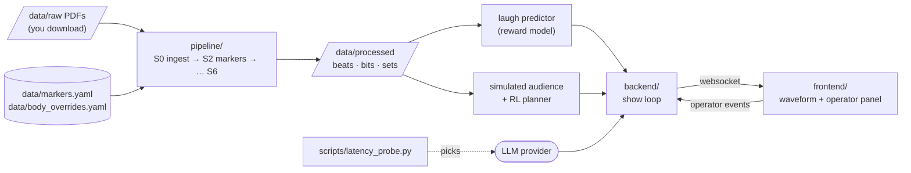

# humor-me

A voice-only stand-up comedy agent that reads the room through laughter and picks its next
bit with reinforcement learning. RL course final project (milestone M1: Dec 15, 2026).

The agent is shown as an animated waveform, speaks through text-to-speech, listens for
laughter, and uses a contextual bandit / sequential policy over "persona modes" to decide what
comes next. Stand-up transcripts are used **only** to learn structure and to label laughs,
never as text the model imitates.

- Design and decisions: [docs/](docs/README.md)
- Agent instructions (rules that must not be broken): [CLAUDE.md](CLAUDE.md)

## Repository map

| Folder | What it is | Status | Details |
|---|---|---|---|
| [`pipeline/`](pipeline/README.md) | Turns transcript PDFs into labeled beats, bits and sets | S0–S2 built; S3–S6 planned | [README](pipeline/README.md) · [wiki](pipeline/wiki/README.md) |
| [`data/`](data/README.md) | Corpus (local only) + committed config: lexicon, body trims | Active | [README](data/README.md) |
| [`backend/`](backend/README.md) | FastAPI server: show loop, websocket to the UI | Scaffold | [README](backend/README.md) |
| [`frontend/`](frontend/README.md) | Next.js UI: waveform avatar, operator panel | Scaffold | [README](frontend/README.md) |
| [`scripts/`](scripts/README.md) | One-off tools: paper PDF → markdown, LLM latency probe | Active | [README](scripts/README.md) |
| [`docs/`](docs/README.md) | Design, roadmap, data sources, pipeline spec, decision log | Active | [README](docs/README.md) |
| [`references/`](references/md/README.md) | Reference papers (local only) and their markdown conversions | Local | [README](references/md/README.md) |

## How the pieces depend on each other



Build order: **setup → pipeline (offline data) → RL training in sim → backend + frontend
(live)**. The backend and frontend can be developed in parallel with the pipeline; they only
need pipeline outputs once the planner and reward model exist.

## Setup

Prerequisites: Python 3.14 (3.12/3.13 may be needed later for audio/ML wheels), Node 24+,
npm, Git. Commands below use Git Bash on Windows; on macOS/Linux replace
`.venv/Scripts/python` with `.venv/bin/python`.

There are **two Python environments** on purpose: the pipeline needs PDF tooling, the
backend needs a web server, and keeping them apart stops dependency conflicts.

```sh
# 1. Tooling env (pipeline + scripts) at the repo root
py -3.14 -m venv .venv
.venv/Scripts/python -m pip install -r requirements.txt

# 2. Backend env
cd backend
py -3.14 -m venv .venv
.venv/Scripts/python -m pip install -r requirements.txt
cp .env.example .env          # then fill in LLM_BASE_URL / LLM_API_KEY / LLM_MODEL
cd ..

# 3. Frontend
cd frontend && npm install && cd ..
```

## Running things, phase by phase

### Phase A: build the transcript dataset (pipeline)

Run from the repo root with the tooling env. Each stage reads the previous stage's output.

| Step | Command | Reads | Writes | Notes |
|---|---|---|---|---|
| 0 | Download PDFs into `data/raw/` | | `data/raw/*.pdf` | Manual. Local only, never committed. |
| 1 | `.venv/Scripts/python -m pipeline.ingest --suggest` | PDFs | appends to `data/body_overrides.yaml` | **Only when you add new PDFs.** Review the proposed counts. |
| 2 | `.venv/Scripts/python -m pipeline.ingest` | PDFs + overrides | `data/interim/*.body.txt`, `*.meta.json` | Stops if a set has no override entry. |
| 3 | `.venv/Scripts/python -m pipeline.markers` | `*.body.txt` + `data/markers.yaml` | `*.clean.txt`, `*.events.jsonl`, updates `*.meta.json` | Stops on unmapped reaction strings → run with `--draft`, review, add to lexicon. |
| 4 | `.venv/Scripts/python -m pipeline.beats` | clean text + events + `datasets.json` | `data/processed/<dataset>/beats.jsonl`, `*.labeled.txt` | S3. Check `labeled.txt` by eye. |
| 5 | `.venv/Scripts/python -m pipeline.bits <set_id>` (or `--all`) | `lines.jsonl` + `backend/.env` | `data/processed/<dataset>/bits.jsonl` | S4+S5 in one Gemini call per set; output validated, cached. Needs `PIPELINE_MODEL` + key. |
| 6 | *(planned)* `pipeline.annotate` / `pipeline.validate` | bits | `sets.jsonl`, metrics | S5–S6 |

Tests (synthetic data only, never reads the corpus): `.venv/Scripts/python -m pytest tests -q`

Rerun from scratch at any time: delete `data/interim/` and `data/processed/`, then run
steps 2 → 3. Everything there is regenerated; `data/raw/` and the two YAML files are inputs.

### Phase B: RL in simulation *(planned, week 2)*

Simulated audience environment + bandit/MDP policies + regret curves. See
[docs/design.md](docs/design.md#simulated-audience-environment-primary-rl-evaluation-for-m1).

### Phase C: live loop

```sh
# Pick an LLM provider by measuring time-to-first-token (needs backend/.env)
backend/.venv/Scripts/python scripts/latency_probe.py --runs 5

# Backend: http://localhost:8000/health, websocket at /ws
cd backend && .venv/Scripts/python -m uvicorn app.main:app --reload --port 8000

# Frontend (second terminal): http://localhost:3000
cd frontend && npm run dev
```

## Data and copyright rules

- Transcripts are fan transcriptions of copyrighted specials. They stay in `data/raw/` and
  `data/interim/`, which are gitignored. Only code, the marker lexicon and trim counts are
  committed. See [docs/data-sources.md](docs/data-sources.md).
- The generator is never trained on transcript text; a memorization guard rejects generated
  lines that overlap transcript n-grams.
- Reference papers stay local; `references/md/README.md` says how to regenerate them.
