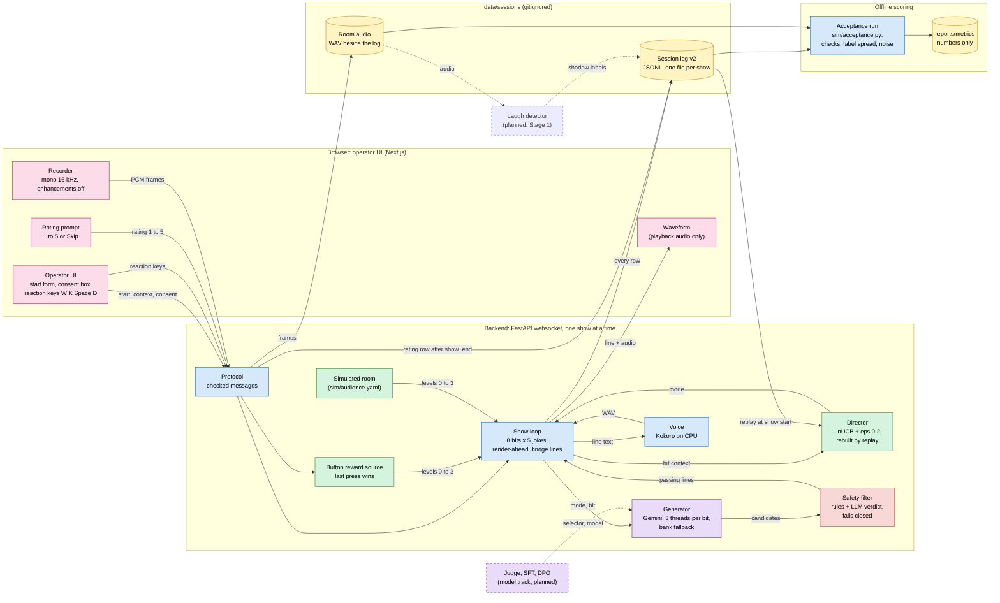

# Design

## Goal

A voice agent (rendered as an animated waveform) that performs stand-up to whoever is in
front of it: sets the stage from the venue, delivers material, handles banter and roasts
(after M1; cut from the Dec 8 demo), and adapts to the room in real time based on laughter. Research first; a working demo is the
vehicle.

## Architecture

What is built through T11 (solid boxes) and what is still planned (dashed). The judge, SFT and DPO plug in at the
generator and the selector. The camera snapshot, speech recognition, banter and roasts are after the Dec 8 demo and are not drawn.



Invariants this keeps: audio only in the loop (no face or video), every row needed to replay a show is in the log, the
mode never reaches the browser, and a rating is the reported outcome, never a training reward.

### Two learning timescales

| Timescale | Mechanism | Updates |
|---|---|---|
| Within a set (seconds–minutes) | Contextual bandit over persona modes | Bandit posterior, in-context "what landed" memory |
| Before the demo (M1) | SFT, then DPO on the generator, from judge preference pairs on our own premises (decisions-detail.md 2026-11-01) | Model weights, offline |
| Across sets (days–weeks, after M1) | Reward model from logged laughs + votes → DPO on generator | Model weights, offline |

No gradient updates during a live show.

### Persona model

- **Core identity** (fixed): self-aware, slightly anxious robot that knows it's on display.
- **Modes** (from HumorGen): Neurotic, Cynic, Observer, Wordsmith, Optimist, Absurdist.
- Contextual bandit chooses modes; add a **switching penalty** so the voice stays coherent.
  The bandit picks a mode; it is the fixed core identity that keeps the voice consistent.

### Contextual bandit

- Arms: 6 modes (optionally × bit type: prepared / crowd work / callback).
- Context (operator-set at session start — no CV, so age can't be inferred):
  - `venue`: bar | company_event | showcase | commute (commute deferred: noise, unclear audience)
  - `energy`: low | normal | high ("hustle Monday" = low)
  - `age`: teens | young_adults | mixed
  - live features: laugh baseline, time into set, recent banter/roast flag, last-mode outcome
- `age=teens` triggers a **stricter safety filter** (no alcohol/sexual content). Hard rule,
  not a bandit decision.
- Venue is a **prior**, not ground truth — live signal must be able to override it.
- Algorithm: start with Thompson sampling or LinUCB. Simple and inspectable.
- Debug offline against simulated audiences before live use.

### Simulated audience environment (primary RL evaluation for M1)

Gym-style env, no LLM in the loop, so thousands of episodes run in seconds:
- Each context `(venue, energy, age)` has a hidden laugh probability per mode, plus noise,
  fatigue (repeating a mode decays its payoff) and a novelty bump early in the set.
- Priors seeded from HumorGen per-persona win rates + stated assumptions per venue.
  **The audience preferences are made up**; the report must say so. The sim tests whether
  the *algorithm* adapts, not whether the jokes are funny.
- Metrics: cumulative regret, laughs/episode, mode-switch count, adaptation speed after a
  mid-set preference shift.
- Policies: fixed best mode, random, ε-greedy, LinUCB, Thompson; ± switching penalty.
- Optional: LLM-persona audiences for qualitative checks only.

## Data and model map

Which data feeds which component, and where it runs. L = laptop (RTX 4060), E = Explorer GPU,
API = Gemini (or Claude) API.

```
rJokes (432k, score 0–11) ──► rjokes prep (L): dedupe, length filter, blocklist, per-year score percentile
        │
        ├──► mode + safety labeling (E: vLLM, 7–8B instruct) on a stratified subset
        │         └──► per-mode score distributions ──► SIM audience priors (with venue assumptions)
        │
        └──► joke scorer (E: encoder regressor, dev/test splits) ──► cheap reranker for K candidates
                                                                    └──► judge calibration (sim idea B)
transcripts (local only) ──► S0–S6 (frozen) ──► aggregate structure stats ──► SET PLANNER targets
HumorGen paper ──► mode definitions + candidate-gen recipe ──► GENERATOR prompts
own premises ──► 6-mode candidates ──► judge pairs ──► SFT, DPO ──► GENERATOR (M1)
own session logs ──► (post-M1) reward model, further DPO
```

| Component | Model | Runs on | Data in | Data out |
|---|---|---|---|---|
| rJokes prep | none | L | rJokes splits | `data/processed/rjokes/*.jsonl` |
| Mode/safety labeler | 7–8B instruct (vLLM) | E | rJokes subset | mode, safety flags per joke |
| Joke scorer | small encoder regressor | E (train), L (infer) | rJokes train/dev | score in [0, 1] |
| Simulated audience + bandits | none (numpy) | L | per-mode priors, structure stats | regret curves, logs |
| Set planner | Gemini flash / local 8B | API or L | context, structure targets | set plan (bits) |
| Bit writer (generator) | Gemini flash-lite / local 8B | API or L | bit spec, mode, set memory | K candidate lines |
| Reranker | joke scorer, later LLM judge | L | K candidates | chosen line |
| Safety filter | blocklist + classifier | L | candidate | pass / reject |

## Long-form set generation

Comedians don't write 10–15 min in one pass either: they build bits and order them into a set.
The generator copies that structure.

1. **Set planner** (once per show, before or at the start): given context (venue, energy, age)
   and structure targets, output 6–10 bit specs: `{premise, mode, target_len, planted_hooks,
   callback_to, role: opener|body|closer}`. Targets come from aggregate transcript stats
   (e.g. words per bit, bits per 10 min, callback rate), never from transcript text.
2. **Bit writer** (per bit, just in time): expands one spec into beats: setup, punch, 1–3 tags,
   optional act-out. K candidates per beat, reranked. Gets set memory (prior premises, landed
   hooks) so callbacks reference what was actually said.
3. **Director** (live): after each beat reads the laugh signal and chooses: tag again, move on,
   cut the bit short, switch mode for the next bit (bandit), or spend a callback.

Length is controlled by the plan: about 130–150 spoken words/min minus laugh time, so a
10 min set is roughly 1,100–1,400 words across 6–10 bits. Each bit is a short generation an
LLM handles well. Quality checks per stage: plan coherence (no duplicate premises, a closer
exists), bit score from the reranker, and whole-set judge review offline.

## Callbacks (cross-bit context)

A callback is the one decision whose payoff is **delayed**: planting a hook in bit 2 earns
nothing until a later bit calls it back. This is what makes the problem a true sequential
decision problem rather than a bandit.

- **Set memory**: each finished bit stores `{premise, mode, landed (max laugh level), hook, used}`.
  `hook` = one memorable image/phrase from the bit (generated set only, never transcript text).
- **Planner action** `callback(k)` alongside "next bit in mode X". Constraints in state: hook
  must have landed (level ≥ 2), ≥ 2 bits since it was planted, ≤ 2 uses with diminishing returns,
  optional closer bonus.
- **Generator** gets the hook + original premise so the payoff references it explicitly.
- **Sim audience** callback model, parameters fit from transcript callback statistics:
  `P(laugh) = base(mode, room) + α·landed_k + β·f(distance) − γ·uses_k`.
- **Key experiment**: greedy bandit (never invests in hooks) vs sequential policy (plants early,
  pays off late). Compare regret and late-set laugh rate.

## Reward design

| Signal | Granularity | Role |
|---|---|---|
| Laugh occurred / duration / onset latency / intensity | Per joke | **Training reward** (normalized to room baseline) |
| Laughs per minute | Per episode | Reported metric |
| End-of-episode rating (1–5) | Per episode | Reported outcome; calibrates laugh signal |
| Pairwise votes ("bit A or B?") | Per episode, training mode | Preference data for RM (Christiano et al.) |

Known biases to control: room-size loudness, novelty ("a robot is talking!"), peak-end bias
in ratings, drunk-audience inflation at bars, delayed laughs misattributed to wrong line.
Expect high noise: HumorGen reports 31.7% inter-annotator agreement, 58.3% judge–human match.

## Modes of operation

- **Show mode**: optimize for performance; log everything.
- **Training mode**: same, plus explicit end-of-episode rating and pairwise votes UI.

## Research hypothesis

H1: Adapting persona mode to live laughter (contextual bandit) yields higher normalized
laughs/min and episode rating than (a) the best fixed mode (Neurotic, per HumorGen) and
(b) random mode per joke.

| Condition | Purpose |
|---|---|
| Plain LLM "be funny" | Floor |
| Fixed Neurotic | Strong static baseline |
| Random mode | Controls for variety |
| **Contextual bandit** | Method |
| Bandit without judge rerank | Ablation: does reranking matter live? |

H2 (later): a reward model trained on logged laughs + votes beats the LLM judge at predicting
live audience response.

## Latency budget

Target: ≤ 1s from end-of-laugh to next line. Achieve by generating/judging the next
candidates *while* the bot is speaking or the room is laughing. Distill to a small model later.

## Audio and consent

The only audio kept is the room's, and only when the operator ticks "The room was told this show is recorded and agreed"
before the show (Massachusetts prohibits secret recording, so the notice comes first). Without the tick no audio is
accepted, no file is created and the show runs as before (`show_start.audio` is `{consent: false, path: null}`).

- **Capture:** the microphone track's own frames (`MediaStreamTrackProcessor`, Chrome), read in a worker when the track
  transfers and on the main thread otherwise, with echo cancellation, noise suppression and auto gain off (they are built
  for calls and would erase the laughter this recording exists for).
- **Transport:** binary frames of 4096 16-bit samples (256 ms) on the same websocket. Binary only ever carries audio and
  every control message is a text frame, so the two cannot be confused. The server answers `start` with `record`, the
  browser opens the mic, and the show begins when the first frame arrives; a mic that fails or stays silent for 15 s
  means the show runs unrecorded.
- **Capture clock, not render clock:** every frame carries a timestamp from the capture clock. Gaps are filled with
  silence and overlaps trimmed, so the WAV sample index equals (timestamp - first timestamp) x 16 kHz whatever the CPU is
  doing; frames are resampled from the device rate to 16 kHz with a windowed-sinc low-pass that keeps its phase. An
  AudioWorklet is driven by Chrome's audio render thread, which misses deadlines while Kokoro uses the CPU and then is
  simply not called: it recorded 65% of real time (see the dev-log), and every later timestamp drifted early.
- **Start time:** the browser sends `audio_start` with the first sample's capture time (epoch ms) before the first chunk,
  and the server uses it for `start_at`; the arrival-based estimate is the fallback.
- **Diagnostics:** the browser reports `audio_health` every ~5 s (audio delivered against capture time, silence filled,
  wall time); the server warns below 99% of either, and also on close when it received under 99% of the wall-clock span.
- **Setup for a show:** no Bluetooth headsets (opening the mic switches them to a low-quality call profile and drops
  samples). In Windows Sound, Communications, choose "Do nothing", or Windows ducks the robot's voice by 80% while the
  mic is open (observed: the voice fell to the noise floor after 20 s). Turn the microphone's **Audio enhancements off**
  (Sound, Recording, the mic's Properties, Advanced or Enhancements) and quit vendor noise-cancellation apps: those drivers
  run echo cancellation below the browser, so Chrome's `echoCancellation: false` cannot stop them, and on the test laptop
  they removed the laptop's own speaker output from the recording (no beeps at all, the robot's voice faint).
- **File:** `data/sessions/<session>.wav` beside `<session>.jsonl`, gitignored. The WAV header sizes are patched after
  every frame, so a dropped connection or a crash leaves a file any reader opens, cut at the last whole frame.
- **Alignment:** `show_start.audio.start_at` is the wall-clock time (the log's `at` timebase) of the first sample,
  estimated as the first frame's arrival minus its length. A line's time in the WAV is `audio_start_at - start_at`.
  Exp 21 measures how far that is off (`python -m sim.evaluate_clock`): beeps are played through the speakers during a
  15-minute show in a simulated room (`GENERATOR=bank`, consent box ticked) and compared with the logged times. Bar: p95 at most 100 ms, no drift.

## Safety

- Hard filter on output: appearance, bodies, protected attributes, named individuals' traits.
- Banter responses target the content of what was said.
- Camera consent notice on UI; no persistence of images/audio of identifiable people beyond
  derived features unless explicit consent in training mode (see Audio and consent above).
