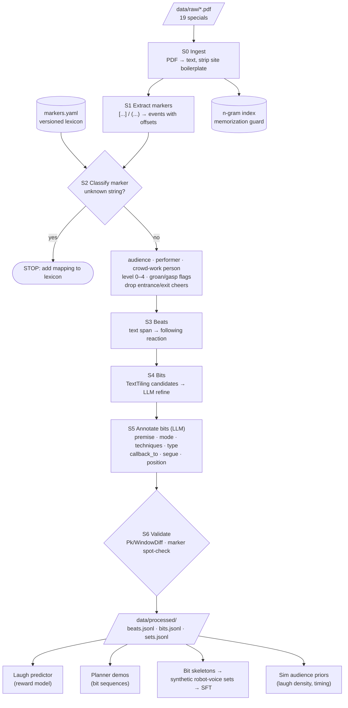
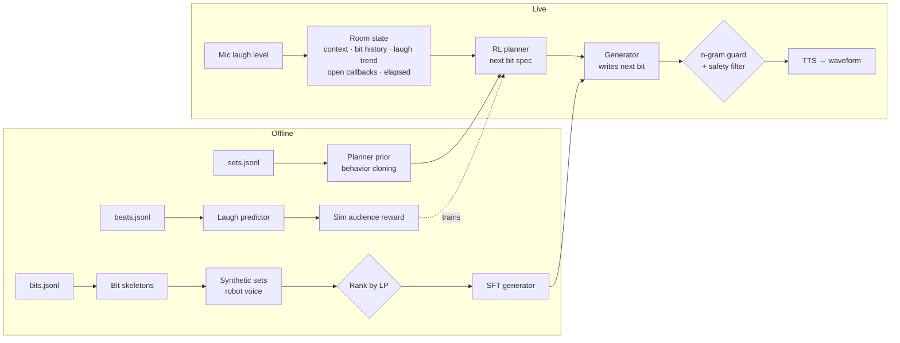

# Transcript Pipeline

Turns locally stored stand-up transcripts into **structure and reward data**: never into
text the model imitates (see decisions.md, 2026-10-20). All data lives in `data/` (gitignored).

## Overview



## How the outputs feed the agent



## Stages

### S0: Ingest
- `pymupdf` text extraction → `data/interim/<slug>.txt`. Slug from filename: `gulman_great-depresh_2019`.
- Strip print chrome (outer page margins), then take the post region between the
  "Stand-Up Transcripts" breadcrumb and the comment section.
- Trim each set by **explicit counts in `data/body_overrides.yaml`** (`skip_leading`,
  `skip_trailing`). Every set must have an entry; a missing one stops the run.
  `--suggest` proposes entries for new sets via heuristics ("Transcript" heading →
  reaction-free `* * *` divider → blurb/title match) for human review.
- Build the **n-gram index** (e.g. 8-grams) of transcript text for the generation-time
  memorization guard. Any generated line overlapping a transcript 8-gram is rejected.

### S1: Extract markers
- Regex `[\[\(]([^\]\)]{3,40})[\]\)]` → event `{offset, raw}`. Remove from the text stream,
  keep offsets so beats can be aligned.

### S2: Classify markers
Lookup in `data/markers.yaml` (lexicon is committed; it holds no transcript text).
Only **reaction-like** strings (laugh, chuckle, applause, cheer, groan, gasp…) need an entry;
an **unknown reaction string stops the pipeline** and lists what's unmapped. A laugh level is
never guessed. `python -m pipeline.markers --draft` proposes entries for human review.
The other ~300 stage directions are bucketed by keyword: `act_out` · `music` · `direction`.

Review notes: performer first names ("jeff laughs", "tom chuckles") are the **performer**,
not crowd-work people; "… continues" extends the preceding **audience** reaction.

| Field | Values |
|---|---|
| `source` | `audience` · `performer` (unattributed chuckles/sighs: subtitle convention) · `person:<name>` (crowd-work turn) |
| `level` | 0 none · 1 chuckle · 2 laugh · 3 big laugh · 4 applause break |
| `flags` | `groan`, `gasp` (separate channel, not ordinal) |

Level rules:
- **1**: audience-attributed chuckle, "scattered".
- **2**: plain laugh ("laughter", "audience laughs").
- **3**: laugh + intensity modifier ("roars", "wildly", "loudly", "continues"), or ≥ 2
  consecutive audience laugh markers.
- **4**: laugh + applause/cheer **inside the set**.
- Cheers/applause in the first/last ~2% of the set = entrance/exit → excluded.

### S3: Beats
- Beat = text span between consecutive audience reaction events (or sentence groups if a
  span exceeds N words).
- Label = level of the reaction that follows (0 if none), plus flags and words-to-reaction.
- Mid-sentence markers flagged `interrupt=true` (the laugh landed before the line finished).

### S4: Bits
- Candidate boundaries: TextTiling-style cosine drop between sentence-window embeddings.
- LLM refines: confirms/moves boundaries.
- Rules: **a bit = one premise**; tags stay inside the bit; a callback is a new bit with
  `callback_to`; crowd-work exchanges are their own bit (`type=crowd_work`).

### S5: Annotate bits (LLM)
Per bit: `premise`, `mode` (HumorGen six), `techniques`, `type`
(`prepared | crowd_work | callback | segue`), `callback_to`, `segue_from_prev`.
`position` (`opener | body | closer`) is assigned by index in the set, not by the LLM.
Annotations are **abstract**: premises are paraphrased descriptions, not quoted lines.

### S6: Validate
- Bit boundaries: hand-label 2 sets → **Pk / WindowDiff**.
- Markers: 50 hand-labeled markers stratified by level → agreement with lexicon mapping.
- Annotations: spot-check 30 bits for mode/premise.

## Schemas

`beats.jsonl`
```json
{"set_id": "...", "beat_idx": 12, "bit_idx": 3, "span": [4120, 4388], "words": 47,
 "level": 2, "flags": [], "interrupt": false, "source": "audience"}
```

`bits.jsonl`
```json
{"set_id": "...", "bit_idx": 3, "beats": [10, 14], "position": "body",
 "type": "prepared", "mode": "Neurotic", "premise": "paraphrased premise",
 "techniques": ["escalation", "act_out"], "tags": 3, "callback_to": [],
 "segue_from_prev": "topic_shift", "max_level": 3, "laugh_rate": 0.6}
```

`sets.jsonl`
```json
{"set_id": "...", "comedian": "...", "year": 2023, "has_markers": true,
 "bits": [0, 1, 2], "split": "train"}
```

## Labels and splits

- **Binary laugh** (level ≥ 2): primary target; robust across transcribers.
- **Ordinal level**: trusted **within a set only**; used as a ranking target.
- **Groan**: separate flag; mode-dependent reward (positive for Wordsmith puns).
- **Density gate**: a set is `laugh_labeled` only if words per audience laugh ≤ 150. Sparse
  transcribers leave most laughs untagged, so missing markers would read as "no laugh".
  Observed: dense sets 26–80 words/laugh; sparse 480+.
  - Labeled (11): Regan, Slay, ISMO, Arcuri, Gaffigan, Morgan, Birbiglia, Bargatze, Chieng,
    Morril, Maniscalco.
  - Structure-only (9): Martin, Bamford, Hamilton, Notaro, Papa (sparse) + Gulman, Seinfeld,
    McIntyre, Meyers (unmarked).
- Levels 1 and 3 are rare (most transcribers tag neither), so the ordinal signal is thin;
  binary stays primary.
- Laugh predictor split: **hold out whole comedians**: Mike Birbiglia (Neurotic, replaces
  Bamford, who is sparse), Jim Gaffigan (Observer), Nate Bargatze (Optimist). That leaves
  **8 training sets**; learning curve at 4/6/8 decides whether more dense transcripts are needed.

## Layout

```text
data/
  raw/          PDFs (gitignored)
  interim/      extracted text, marker events (gitignored)
  processed/    beats/bits/sets jsonl, n-gram index (gitignored)
  markers.yaml  lexicon (committed)
pipeline/       code (committed)
```
