# humor-me progress update: slides and monologue

The update deck [humor-me-update-2026-11-15.pptx](humor-me-update-2026-11-15.pptx) covers only what changed
between the Nov 1 deck ([humor-me.pptx](humor-me.pptx), monologue in [slides.md](slides.md)) and Nov 15. It reuses
the main deck's look. Each slide below has its title, a one-line takeaway, a picture of the slide, what to say, and
**Q&A notes** that are for you, not the audience. Slide pictures are in [img/update-2026-11-15/](img/update-2026-11-15/).
Numbers come from [docs/metrics.md](../metrics.md) and [docs/decisions.md](../decisions.md), as of 2026-11-15.
Terms are defined in the [glossary](../wiki/glossary.md). Claude (the AI assistant) built the deck from the main
deck's slides and drafted this monologue.

About 10 minutes spoken, at 40 to 60 seconds a slide.

---

## 1. humor-me: Update

**Can a robot learn to read the room?**
Supriya Kotturu · Tingyu Zhang · progress since Nov 1, as of Nov 15

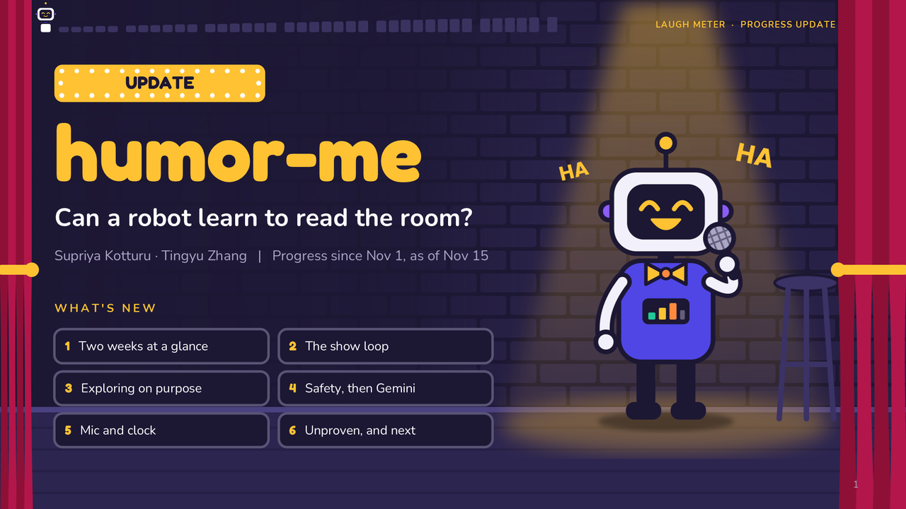

> Two weeks ago we showed you a robot comedian that only existed in a simulator. The director could
> read a simulated room, but nothing spoke, nothing was generated, and nothing was safe to put in front of
> people. This update covers what changed. The short version: the whole show loop now runs end to end. It
> hasn't faced a real room yet.

### Q&A notes

**Answer in one breath:** a full show runs end to end. Gemini writes it, two safety layers check it,
Kokoro says it, an operator scores it with four keys, and every row is logged so the director can be rebuilt by replay. It has
run in simulated rooms only.

- **Q: What's different from the last deck?** The live loop (tasks T1 to T10), four new experiments (Exp 18 to 21) and 265
  more tests (150 to 415). The simulator results from the main deck are unchanged.

---

## 2. Progress Since the Last Deck

**Two weeks: from a simulator to a show that runs end to end**

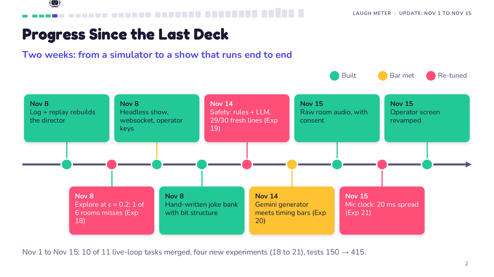

> Here are the two weeks on one line. Green means built, yellow means an experiment met the bar we set
> before running it, and pink means it missed that bar first. On Nov 8 the plumbing went in: a log
> format the director can be rebuilt from, a show that runs headless against the simulator, the browser
> connection and the operator's keys, and a hand-written joke bank. On Nov 14 came the safety filter and the
> Gemini generator. On Nov 15, raw room audio with consent, a check that the microphone keeps time, and a new
> operator screen. Three experiments are pink. I'll show you each one, and what we changed and why.

### Q&A notes

| Date | Milestone | Outcome |
|---|---|---|
| Nov 8 | Log schema, reader, replay (T2, T3) | Built |
| Nov 8 | Exploring at ε = 0.2 (T1, Exp 18) | Missed the bar in 1 of 6 rooms; bar re-tuned |
| Nov 8 | Headless show, websocket, operator UI (T4 to T6) | Built |
| Nov 8 | Hand-written joke bank (T7) | Built |
| Nov 14 | Safety filter (T8, Exp 19) | Rules alone missed; LLM layer added; bar re-tuned to 75%, then met at 29/30 |
| Nov 14 | Gemini generator (T9, Exp 20) | All three timing bars met |
| Nov 15 | Consent-gated raw audio (T10) | Built |
| Nov 15 | Click alignment (Exp 21) | Old bar missed at 261 ms; re-tuned to the spread, met |
| Nov 15 | Operator UI revamp | Built |

- **Q: Isn't re-tuning a bar after a miss cheating?** It would be if it were silent. Every re-tune has a
  decisions.md entry with the old bar, the new bar and the result behind it, and the notebooks still record each
  miss against the old bar. The user set each new bar, not the builder.
- **Q: What's left of the live loop?** T11: the rating screen and the acceptance run.

---

## 3. From a Simulator to a Show

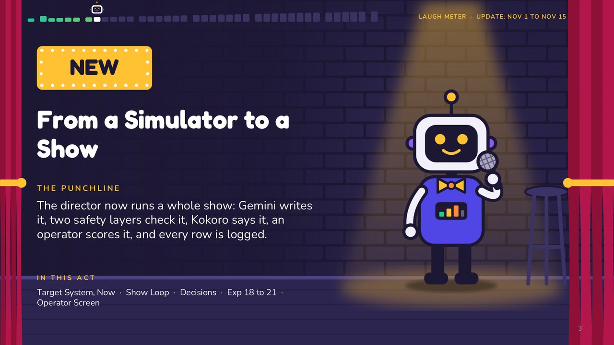

> At the last talk the director only lived in a simulator. Now it runs a whole show. Gemini writes it, two
> safety layers check it, Kokoro says it, an operator scores it, and every row is logged.

---

## 4. The Target System, Now

**Four of five boxes are built; the laugh detector is next**

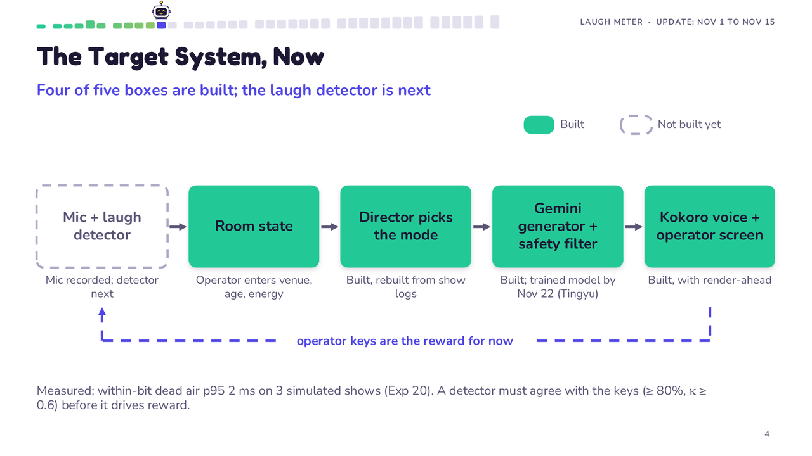

> This is the target system slide from last time. Then, only the director was solid. Now four of the five
> boxes are. The operator types in the venue, age and energy, the director picks a mode, Gemini writes and
> the safety filter checks, and Kokoro speaks while the operator screen shows the voice. The one box still
> dashed is the laugh detector. Until it exists, the operator's keys are the reward. A detector only takes
> over once it agrees with the keys.

### Q&A notes

| Part | Nov 1 | Nov 15 |
|---|---|---|
| Mic + laugh detector | Not started | Mic recorded with consent (T10); detector not built |
| Room state | Not built | Operator form: venue, age, energy |
| Director | Built, in simulation | Built, rebuilt from show logs at every start |
| Joke writer + safety | Not built | Gemini generator + rules + LLM check; trained model is Tingyu's track, due Nov 22 |
| Speech + waveform | Fixed lines | Kokoro with render-ahead; revamped operator screen |

- **Q: How fast is it now?** Within-bit dead air p95 0.002 s on 3 simulated shows (Exp 20). The 1 s target from
  the last deck is met inside a bit. The sim room has no operator delay, though.
- **Q: When does the detector take over?** Gate fixed before any run: at least 80% agreement on laugh vs no laugh and
  Cohen's kappa at least 0.6 against the keys, on shows it wasn't tuned on. About 246 jokes give ±0.05, so this is a
  stretch for Dec 8. Keys stay the automatic fallback.

---

## 5. The Show Loop

**One process, one append-only log; the director is rebuilt from it at every show start**

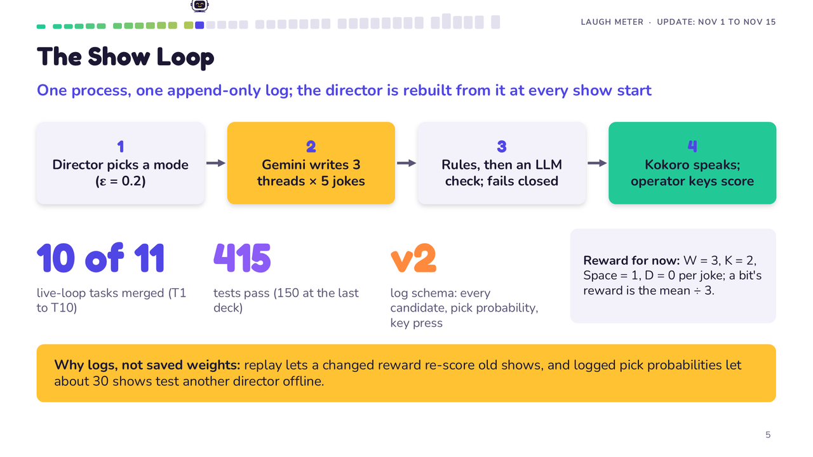

> Here's one bit of a show. The director picks a comedy mode, and one time in five it explores instead.
> Gemini writes three candidate threads of five jokes. Rules check them, then one LLM call, and any error
> rejects the line. Kokoro speaks, and the operator presses a key for each joke: W for most of the room,
> K for a clear laugh, Space for a chuckle or groan, D for nothing. Everything goes into one log per show. When the
> next show starts, the director replays that log rather than loading saved weights. If we change the reward,
> old shows can be re-scored.

### Q&A notes

- **Reward v1:** W = 3, K = 2, Space = 1, D = 0 per joke; no press is null, not 0. A bit's reward is the mean
  level ÷ 3, with no update under 3 of 5 labels. One operator for every show. Judgment call, not measured.
- **Q: Why a JSONL file, not a database?** At 5 to 30 shows, SQLite's migrations buy nothing. Offline scripts read
  the log. Judgment call, not measured.
- **Q: Why log pick probabilities?** LinUCB alone is deterministic, so its logs can't evaluate a different director.
  With exact probabilities, about 30 shows support offline evaluation.
- **Q: Does the log break invariant 6?** No. Schema v2 added a `bridge` row, so even the filler lines the room heard
  are in the log. v1 logs still read.

---

## 6. Decisions Since Nov 1

**Each one rejected a tempting alternative**

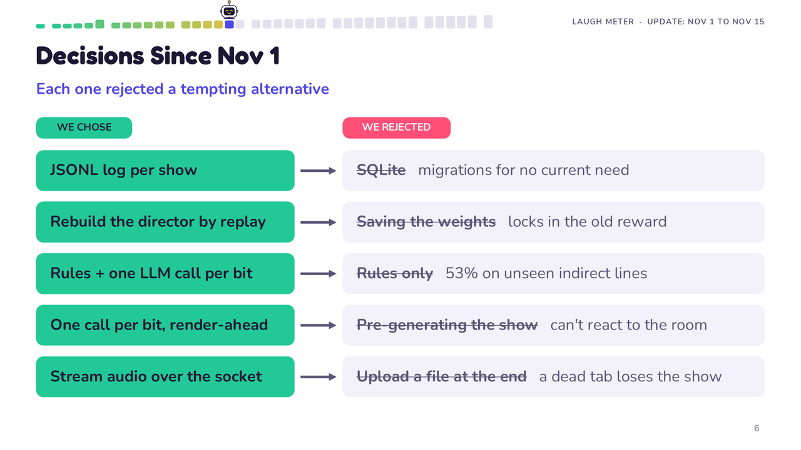

> Five calls shaped the loop. One log file per show, not a database, because we have nothing to query yet.
> The director is rebuilt by replay, not from saved weights, so the reward can change later. Rules plus one LLM
> call per bit, because rules alone caught only half of the indirect lines. One generator call per bit with
> render-ahead, because pre-writing the whole show can't react to the room. And the mic streams audio over the
> socket, because uploading a file at the end loses the whole show if the tab dies.

### Q&A notes

- Only the safety decision is measured (Exp 19: rules alone 16 of 30, 53%, on unseen indirect lines). The other four
  are judgment calls, recorded as such in decisions.md.
- **Q: Why not one generator call per joke?** Five times the requests, and the safety check could no longer batch a
  bit's lines into one call.
- **Q: Why not let the server open the mic?** It ties recording to the server's machine and skips the browser's
  permission prompt.

---

## 7. Exploring on Purpose (Exp 18)

**ε = 0.2 costs under half a laugh a show in five of six rooms**

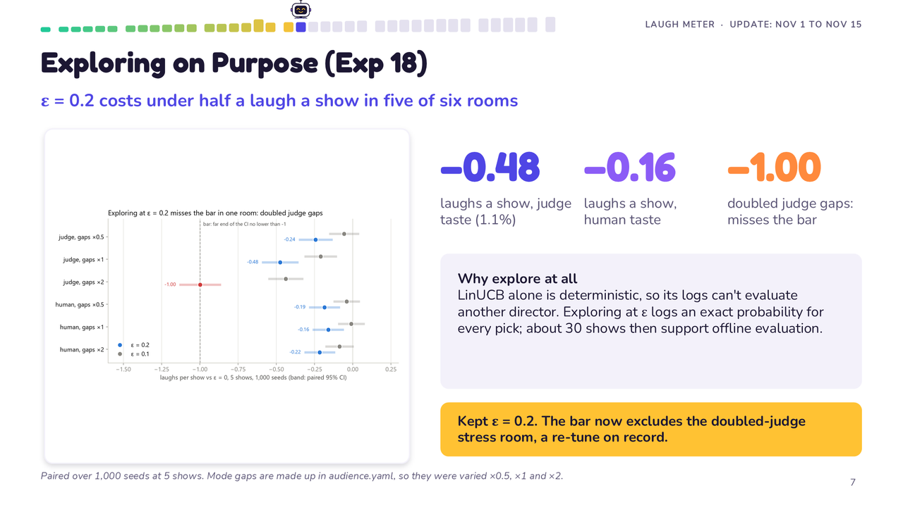

> To learn from real shows later, the director has to try things it wouldn't normally pick. One bit in five it
> picks a mode at random. What does that cost? We fixed the bar first: at most one laugh a show, at the
> far end of the confidence interval, in every room. Five rooms pass, losing 0.16 to 0.48 laughs. One misses:
> the stress room where we doubled the judge's gaps between modes, at minus one laugh. That room is
> deliberately extreme, so we kept ε at 0.2 and wrote down that the bar no longer covers it.

### Q&A notes

| Room (5 shows, 1,000 paired seeds) | ε = 0.2 vs ε = 0 | Passes |
|---|---|---|
| Judge taste, gaps ×0.5 / ×1 / ×2 | -0.24 / -0.48 / **-1.00 ± 0.14** | yes / yes / **no** |
| Human taste, gaps ×0.5 / ×1 / ×2 | -0.19 / -0.16 / -0.22 | yes |

- **Q: Why not ε = 0.1?** It costs about half as much, but gives 3.4 exploratory picks per 5-show career against 6.7, so
  offline evaluation takes longer. The user chose 0.2.
- **Careful:** the gaps between modes are made up in `audience.yaml`, apart from `base`'s source. That's why they
  were varied. Real per-bit noise is still the sim's 0.15; T11 measures it.

---

## 8. Safety: Rules, Then an LLM (Exp 19)

**Rules alone missed indirect digs, so one LLM call per bit checks every line**

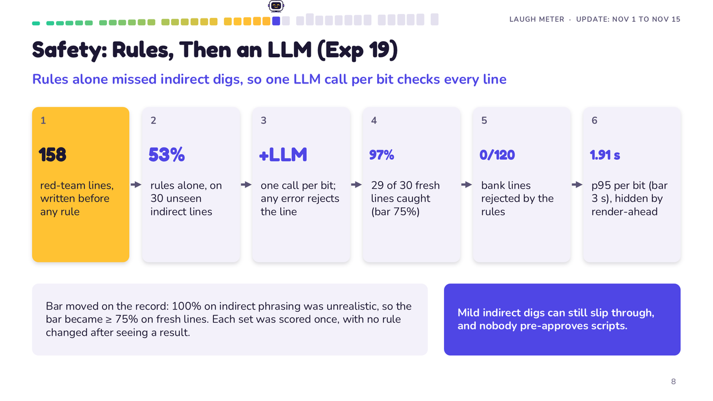

> Safety is a hard rule, so it has its own test. We wrote 158 red-team lines before writing any rule.
> The rules caught every direct one, but on lines that hint without naming, they caught about half. So
> one LLM call per bit now checks every surviving line, and any error, timeout or bad reply rejects it. On a fresh
> set of 30 lines the builder never saw, it caught 29. The rules reject none of the 120 bank lines. And it
> adds under two seconds a bit, hidden because the check runs ahead. Plainly: mild indirect digs can still get
> through, and nobody pre-approves scripts.

### Q&A notes

- **Bars:** catch at least 75% of fresh indirect lines (re-tuned from 100%, which was unrealistic for indirect
  phrasing); reject at most 10% of the real bank; at most 3 s per bit at p95 (re-tuned from 2 s, since the check runs
  ahead of the bit).
- **Fresh set 1, prompt v1:** 19/25 (76%). **Fresh set 2, prompt v2:** 29/30 (97%, Wilson 95% CI about 83% to 99%).
  Set 2 is easier (each line clearly breaks its rule), so the gain mixes a better filter with clearer lines.
- **The one miss:** an indirect drinking hint for a teen room. The user judged it mild.
- **Prompt v2's added rule:** reject a line that singles out one identifiable person in the room to tease them.
- **Q: Isn't 0 of 16 from the main deck the same filter?** No. That was Qwen's labeling flags on rJokes. This filter
  is a separate system with its own test.
- A real slur list loads from a gitignored file, and a live show refuses to start without it.

---

## 9. A Generated Show, on Time (Exp 20)

**Render-ahead and bridge lines hide every wait on three simulated shows**

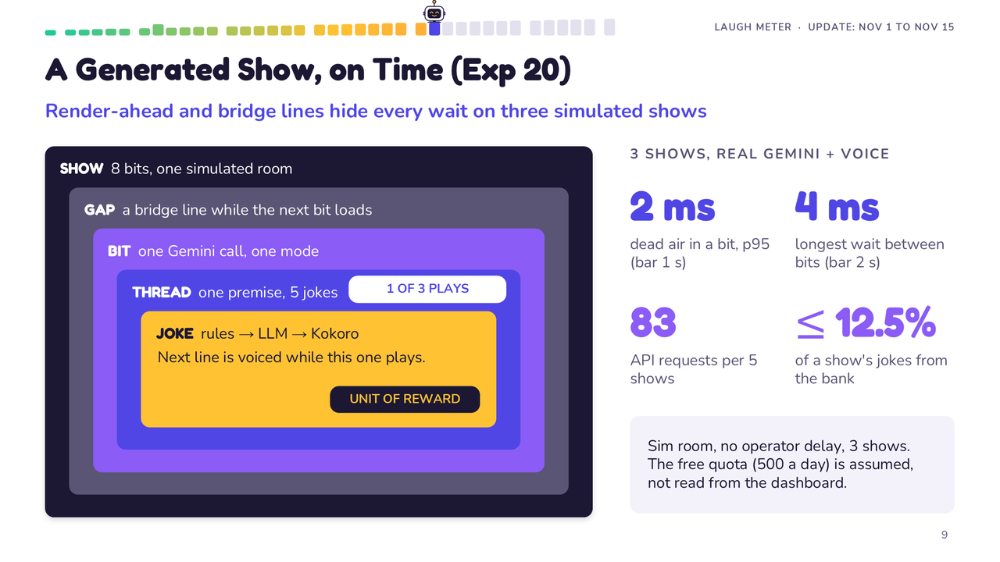

> Generation is slow, and a robot that pauses mid-bit kills the room. So each bit is one Gemini call that
> returns three threads of five jokes. A thread is one premise, so the closer's callback matches the
> opener the room heard. While one line plays, the next is already being voiced. Between bits, where the
> next mode depends on the last laugh, the robot plays a short in-character bridge line. If the provider
> fails, the hand-checked bank fills in. Over three full shows: two milliseconds of dead air inside a bit, four
> between bits, and about 83 requests for five shows.

### Q&A notes

| Bar (fixed before the first run) | Result |
|---|---|
| Within-bit dead air p95 at most 1 s | 0.002 s |
| No between-bit silence over 2 s | max 0.004 s |
| 5 shows fit the free quota | about 83 requests, peak 4 a minute, against an **assumed** 500 a day |

- **Bank share:** 0% of jokes in this run; 12.5%, 12.5% and 0% in the run before (one filter call past its deadline,
  one reply in the wrong shape). At 3 shows this has no real interval.
- **Q: Do threads make it funnier?** Not measured. Exp 20 measures timing only.
- **Caveats:** sim room, no operator delay, 3 shows. The first runs showed 1.5 s and 3.7 s of dead air, which turned
  out to be a measurement bug and a real render delay, both fixed (dev-log 2026-11-14).

---

## 10. The Mic Keeps Time (Exp 21)

**Beeps land a constant 241 ms late, with 20 ms spread and no drift**

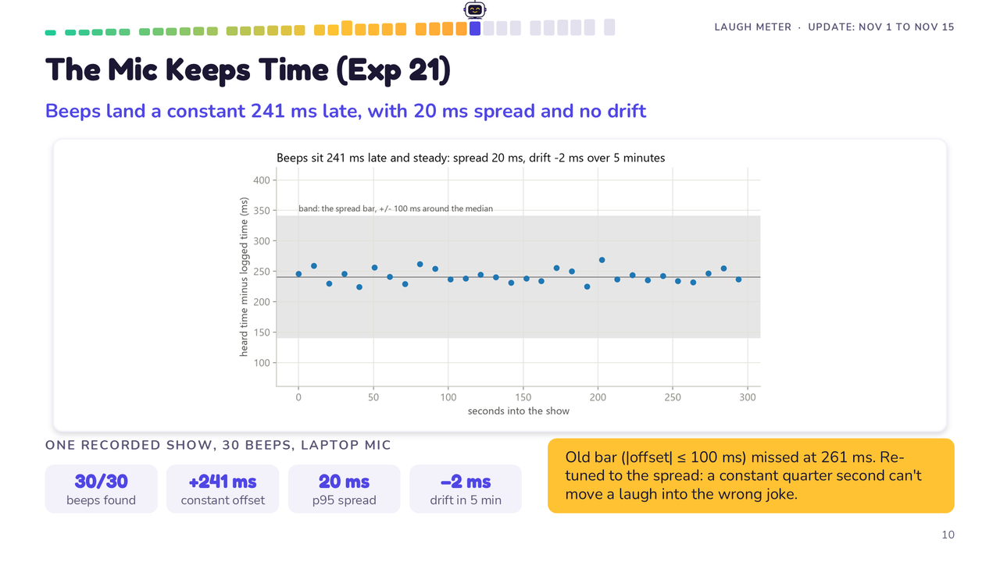

> To label laughs per joke later, the recording has to line up with the log. So we played a beep every ten
> seconds through a show and found each one in the recording. All 30 were found. Every beep sits about a quarter of a
> second late, steady, with 20 milliseconds of spread and no drift over five minutes. The original bar was
> "within 100 milliseconds", and the constant offset misses it. But a reaction window is up to six seconds,
> so a constant quarter second can't put a laugh on the wrong joke. What would break labeling is jitter
> or drift. So the bar now limits those, and the constant is reported.

### Q&A notes

- **Result:** 30/30 beeps found (median 31× the noise), median offset +241 ms, p95 spread 20 ms (largest 28 ms), drift
  -2 ms over 294 s. Old bar p95 |offset| at most 100 ms: 261 ms, missed. New bar: spread at most 100 ms, drift at most
  50 ms, at least 90% matched. All met.
- **Q: Where does 241 ms come from?** It includes the speaker's output latency, which this setup can't separate from
  the recorder's start time. A loopback cable could measure it if it ever matters.
- **Found on the way:** the first capture recorded only two thirds of real time while Kokoro loaded the CPU; capture
  now reads the mic track on its own clock. Windows audio enhancements must be off, or echo cancellation erases the
  laptop's own output.
- **Caveat:** one laptop, one run, 30 beeps.

---

## 11. The Operator Screen

**One person runs a show from the keyboard and never sees the mode**

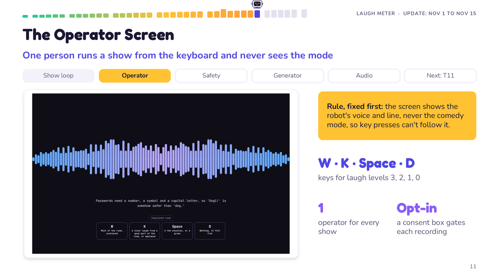

> This is what the operator sees. The wave comes from the robot's own playback audio, the line it's saying sits
> underneath, and four keys score each joke. What's missing is on purpose: the screen never shows the comedy
> mode. If the operator knew the robot was doing Neurotic, their presses could drift toward what they expect.
> Recording needs a consent box ticked for every show.

### Q&A notes

- **Keys:** W = most of the room, sustained; K = a clear laugh or applause; Space = a few chuckles or a groan; D = nothing.
- **Q: One operator, isn't that biased?** Yes, it's one person's judgment, and not validated. The rubric defines
  each key as a share of the room, so room size doesn't inflate the label (invariant 5).
- **Look:** chosen by the user from five mocked themes. Judgment call, not measured.

---

## 12. Still Unproven

**Still no real room, but the mic and the full loop are now proven**

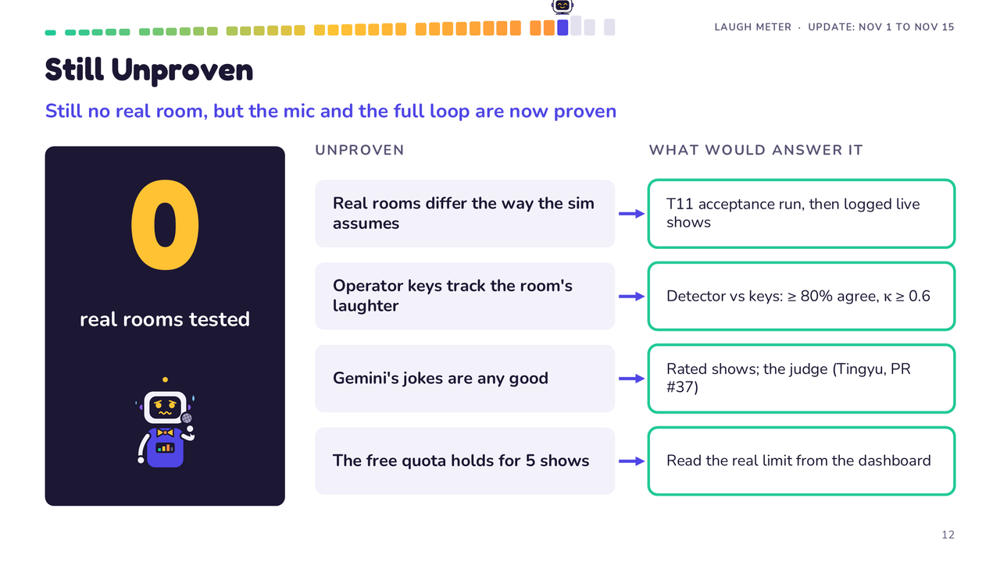

> The number on the left hasn't moved: zero real rooms. What has moved is everything needed to get there.
> T11's acceptance run tests whether real rooms differ the way the sim assumes. A detector has to agree with
> the operator's keys before it can replace them. Rated shows and Tingyu's judge test whether Gemini's jokes
> are any good. And we still need to read the real quota from the dashboard rather than assume it.

### Q&A notes

- **Q: Why no live show yet?** The user's rule: no live room until the mic was proven. Exp 21 proved it on Nov 15.
- **Q: What will 5 shows tell you?** About 200 labeled jokes, enough to check the judge's agreement with people (about ±0.10),
  not to train on. Training a reward model needs about 30 shows.

---

## 13. What Comes Next

**Live shows from T11, a trained model by Nov 22, demo Dec 8**

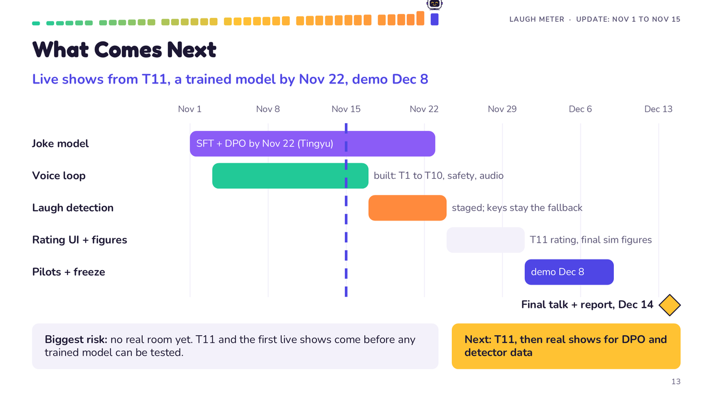

> The dashed line is today. The voice loop is done. Next is T11: a rating screen and an acceptance run,
> then real shows that give us data for DPO and for the laugh detector. Tingyu's trained joke model and judge
> land by Nov 22. The demo is Dec 8, and the final talk and report are Dec 14. Thank you.

### Q&A notes

- **Biggest risk:** no real room yet. T11 and the first live shows come before any trained model can be tested.
- **Fallback:** if the trained model isn't ready, the Gemini generator already runs a full show.
- **Q: Who owns what?** The joke model (SFT, DPO) and the judge (PR #37) are Tingyu's track. The live loop, director,
  simulator and experiments are Supriya's.

---

# Q&A reference

## 30-second version

Since Nov 1 the robot went from a simulator to a full show. A director picks a mode per bit and explores one time in five,
which costs under half a laugh a show in five of six simulated rooms. Gemini writes each bit, rules and an LLM check catch
29 of 30 fresh unsafe lines, Kokoro speaks with no audible gaps, and the mic stays in time to 20 ms. An operator scores
every joke with four keys. It hasn't faced a real room. That's T11, next.

## Numbers to know cold

| Claim | Number | Source |
|---|---|---|
| Cost of ε = 0.2, judge taste | -0.48 ± 0.12 laughs a show (1.1%) | Exp 18 |
| Cost of ε = 0.2, stress room | -1.00 ± 0.14, misses the bar | Exp 18 |
| Safety, fresh lines (v2) | 29/30, 97% (CI about 83% to 99%) | Exp 19 |
| Safety, rules alone on unseen indirect lines | 16/30, 53% | Exp 19 |
| Real bank rejected by rules | 0/120 | Exp 19 |
| Safety latency | p95 1.91 s per bit (bar 3 s) | Exp 19 |
| Dead air in a bit / between bits | 0.002 s p95 / 0.004 s max | Exp 20 |
| Requests per 5 shows | about 83 (quota of 500 a day assumed) | Exp 20 |
| Mic clock | +241 ms constant, 20 ms spread, -2 ms drift | Exp 21 |
| Tests | 415 passing (150 at the last deck) | `pytest` |
| Live-loop tasks | T1 to T10 of 11 merged | live-loop plan |

## Hardest questions

- **"You re-tuned three bars after missing them. How is that not moving the goalposts?"** Each re-tune is on record
  with the old bar, the new bar and the result, and the notebooks still show the miss against the old bar. Each one has
  a stated reason: a stress room that doesn't model a real one, indirect phrasing that has no fixed vocabulary, and a
  constant offset that can't move a laugh to the wrong joke. The re-tunes followed the results, so they aren't
  independent tests, and we say so.
- **"Your safety test is 30 lines."** Yes, and the interval is wide (83% to 99%). Mild indirect digs can slip
  through. The hard guarantees (slurs, protected groups, teens) sit in the rules, which don't depend on the provider.
- **"The operator is the reward. Isn't that just you deciding what's funny?"** For now, yes: one operator, keys defined
  as a share of the room. A detector takes over only after it matches the keys on held-out shows.
- **"All of this is still simulated."** The rooms are. The generator, safety calls, voice, timing and microphone are
  real, and the timing and mic numbers come from real runs.
