# humor-me: slides and monologue

Each slide has a title, a one-line takeaway, its picture, and what to say. Diagrams are PNGs in
[img/](img/), with their Mermaid source beside them (`.mmd`). Result charts come from
[reports/figures/decision-plot/](../../reports/figures/decision-plot/), built by
[decision-plot.ipynb](../../notebooks/decision-plot.ipynb). Other experiment figures come from
[reports/figures/](../../reports/figures/) and [assets/labeling/](../../assets/labeling/).
Fonts: Junge 36 pt for titles, Nunito Bold 18 pt for takeaways, Nunito 14 pt for body text.

Each slide also has **Q&A notes**: the numbers behind it and the questions it invites. They are for you,
not the audience. [Q&A reference](#qa-reference) at the end has the
overall summary and the hardest questions. Numbers come from [docs/metrics.md](../metrics.md) and
[docs/decisions.md](../decisions.md), as of 2026-11-01. Terms are defined in the
[glossary](../wiki/glossary.md).

**Still yours to decide.** These are left as written:

| Slide | As written | What the evidence says |
|---|---|---|
| 12 | Baseline F1 0.21 | `segmentation_bargatze.json` says F1 0.204 (its precision is 0.213) |
| 17 | Title says "Reinforcement Learning"; takeaway says "Dynamic Audience State" | LinUCB is a contextual bandit, and slide 20 shows it can't follow a room that changes mid-show |
| 28 | "This is the real run" | The screenshot is a 15-second summary job printing finished results. The labeling took about 5 h across earlier jobs |
| 29, 31 | "The judge" means two different models | Slide 29's judge is our Qwen labeler. Slide 31's is HumorGen's Llama 3.3-70B. Say which |
| 30 | Median absurdist joke is 26 words | `mode_ranking.json` and the glossary say 25 |
| 32 | "Asked why the threshold was 0.05, I found..." | You asked; Claude found the flaw (decisions.md 2026-11-01) |

---

## 1. humor-me

**Can a robot learn to read the room?**
Supriya Kotturu · Tingyu Zhang · RL course final project, Nov 2026

> LLMs can plan a trip, write code and reason through a proof. So here's a harder question: can one do
> stand-up? Not tell a joke, do stand-up. This project is a voice-only robot comedian that performs a
> set, listens for laughter, and learns from it. I'll tell you what we built, what worked, and the
> places it failed.

### Q&A notes

**Answer in one breath:** in simulation, a director that adapts to the room gets 97% of the laughs of one that
knows the room's taste (about 95% of the true best), and 18% more than always performing as Neurotic. No joke has been generated or
performed yet.

- **Q: What exists today?** The simulator, the director policies, the rJokes analysis and 16 notebook
  experiments, plus a first voice slice: three hand-written lines spoken by Kokoro on the CPU, with a browser frequency display and session logs. The trained joke model, laugh detection, safety filter and the director in the live loop are not built yet.
- **Q: Who did what?** Decide this with Tingyu before the talk. Every commit in the repo is under Supriya's
  name, and the docs don't record a split. Claude's part is on slides 35 and 39.
- **Q: Is there a demo?** Not a full one yet: the voice slice speaks fixed lines only. The plan is the agent on screen with its waveform and audio, speaking jokes from a model we
  trained, by Dec 8. If it slips, the RL results still stand on the simulator.

---

## 2. Act 1: Why a Joke Needs a Room

### Q&A notes

**This act says:** LLM humor has no audience, and a comedian's craft is a feedback loop, so RL is a fair frame.

---

## 3. What LLM Jokes Miss

**LLM lacks taste. Humor needs it.**

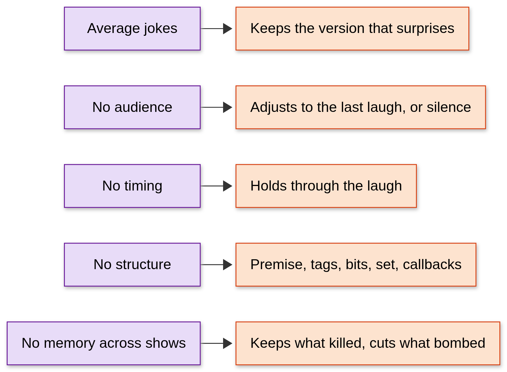

> I believe LLMs can't do stand-up, at least not good stand-up. I'm trying to find evidence of how bad
> it can get. Ask a model for a joke and you often get retrieval: the same dad jokes, falling flat.
>
> The left column is what's missing. The jokes are average, because decoding favors likely text and
> humor lives in surprise. There's no audience, no timing, no structure, and every prompt starts
> fresh. The right column is what a comedian does about each one. Papers like HumorGen and LoL work on
> the first gap. Neither has an audience, timing or set structure. That gap is this project.

### Q&A notes

- **Q: Did you measure how bad LLM jokes are?** No. This slide is reasoning plus the papers. "How bad it gets" is
  still the open question, because the generator isn't built.
- **Q: Why "average jokes"?** Decoding favors likely text. HumorGen calls this mode collapse: the model keeps
  producing the same safe region of jokes.
- **HumorGen vs LoL (common mix-up).** HumorGen: six personas, candidate generation, LLM judge, distillation.
  LoL: thought-leap reasoning plus a frozen pairwise judge. LoL doesn't classify personas.
- **How noisy is humor?** In HumorGen's human check (3 evaluators, 180 judgments on 60 pairs), evaluators agreed
  on 31.7% of pairs. Its judge matched the human consensus on 58.3% of pairs and individual votes on 52.4%.

---

## 4. The Comedian's Loop Is RL

**Try a bit, hear the room, change the next show**

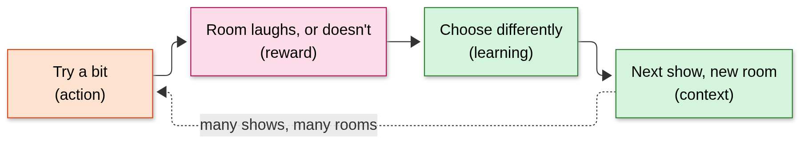

> A new comedian isn't a writer telling a long story. They write short bits, try them in different
> rooms, and keep what works. That is reinforcement learning: the bit is an action, the laugh is a
> reward, and the next show is the update. It takes many rooms to learn that the cynical material
> kills at a bar and dies at a company party. Taste, at least part of it, is what that loop leaves
> behind.
>
> So my question is: **does adapting to the room beat performing one fixed persona?**

### Q&A notes

| Comedian | RL term | In the project |
|---|---|---|
| Picks an attitude for the next bit | Action (arm) | One of 6 modes |
| Hears the room | Reward | Mean laugh level of the bit ÷ 3, from 0 to 1 |
| Knows the venue and crowd | Context | Venue, energy, age, last mode and how it landed |
| Next show | Update | Weights carry across shows |

- **Q: Is this really RL?** Today it's a contextual bandit: see context, pick an arm, see only that arm's reward.
  That's the simplest form of RL, and it assumes actions don't change the future. Fatigue already bends that,
  and callbacks would break it.
- **Q: Taste is what the loop leaves behind?** That's the thesis, not a result. The loop picks an attitude. It
  doesn't learn what makes a joke funny.
- **Hypothesis H1:** adapting beats the best fixed mode and random, live. Only the simulated version is tested.

---

## 5. The Target System

**A voice-only loop where laughter trains the director**

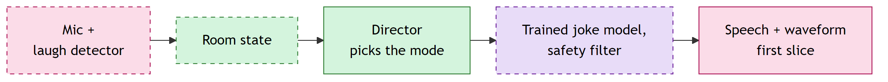

> Here's where we're heading. A mic hears the room, a laugh detector turns that into a signal, with an
> operator button as a fallback. A director picks the attitude for the next bit, a joke model we
> train writes candidates, a safety filter checks them, and the robot speaks. Be clear on status: solid
> means built. The director is, in simulation, and so is a first slice of speech and waveform, speaking fixed lines. Everything dashed isn't built yet.

### Q&A notes

| Part | State |
|---|---|
| Director | Built, in simulation only |
| Mic, laugh detector, operator button | Not started; the detector is planned for Nov 17 to 23 |
| Trained joke model, safety filter | Not built; model track Nov 1 to 22 (latest SFT Nov 15, DPO Nov 22), with Gemini as the fallback. Judge rerank is optional |
| Speech, waveform | First slice built: fixed lines, Kokoro on the CPU, browser audio and a frequency display, with session logs. Not yet connected to a generator or the director |

- **Q: How fast must it be?** Target is 1 s or less from the end of a laugh to the next line. Measured so far:
  about 0.6 s to the first token on Gemini flash-lite. That's one piece, not the whole loop. Kokoro takes 1.9 to 3.7 s to render 5 to 8 s of audio, faster than real time but over the target, so the next line must be rendered while the current one plays.
- **Q: What if the detector fails?** A person presses a laugh button, and that becomes the reward.
- **Q: Does it learn during the show?** The director's weights update between bits. No model gradients run during
  a show.

---

## 6. Day-One Decisions

**Each rule rejected a tempting alternative**

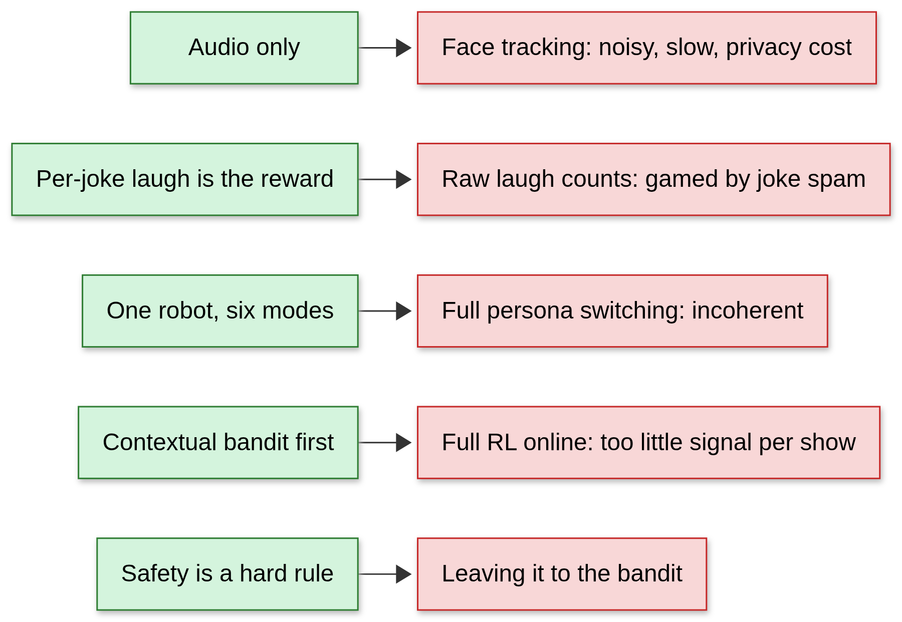

> These were fixed on day one. Audio only, since face tracking is noisy and slow, and without video the
> robot can't joke about how anyone looks. The per-joke laugh is the reward, because raw laugh counts
> can be gamed by spamming jokes. One robot with six modes, because switching whole personas is
> incoherent. A bandit first, because one show gives too little signal for full RL. And safety is a
> hard rule, never something the bandit gets to learn: no jokes about bodies or protected attributes,
> and a stricter filter for teens.

### Q&A notes

- **Why not an end-of-show rating as the reward?** One number per show is sparse and biased toward the peak and
  ending. The rating is the reported outcome; the per-joke laugh is the training reward.
- **Why not raw laugh counts?** More jokes means more laughs, and a bigger room is louder. The live signal gets
  normalized to the room's baseline. That normalization isn't built.
- **How does it know age, if it's audio only?** It doesn't. An operator sets venue, energy and age. The optional
  camera snapshot is cut from M1.
- **Q: Why a bandit first?** An 8-bit show gives too little signal for full RL online.
- **Careful:** the safety rule is a design decision. The filter isn't built, and slide 29 shows rJokes' safety
  labels can't help. Teens get no alcohol or sexual content, as a hard rule outside the bandit.

---

## 7. Act 2: How a Comedian Builds a Set

### Q&A notes

**This act says:** comedy has units, and each maps to a decision. Mining them from transcripts worked for bits, failed
for callbacks, and got paused.

---

## 8. The Units of Comedy

**A joke sits inside a bit, a bit inside a set**

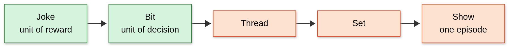

> Before modeling comedians, I had to learn their units. A joke is a setup, a punch and maybe some
> tags. A bit is one premise worked through, the smallest stretch that stands on its own. Bits on the
> same topic form a thread, threads and bits form a set, and one set in front of one audience is a
> show. Two of these matter most: the joke is my unit of reward, and the bit is my unit of decision.
> In my hand labels of Nate Bargatze's *Hello World*, a median bit runs 118 words and earns 4 laughs.

### Q&A notes

**Numbers (hand labels, Bargatze *Hello World*):** 52 bits, median 118 words (about 17 lines), median 4 laughs per
bit, middle half 2 to 7 laughs. 3 callbacks. Bits form 37 threads in the metrics file (a decision entry says 38).

- **Q: Is one special enough?** Not for general claims. It set definitions and scale, nothing more.
- **Q: The sim uses 5 jokes per bit. Why not 4?** 5 is a round design value close to the median, not fitted.
- **Laugh levels:** the sim uses 0 to 3. The transcript pipeline also has a level 4, which is an applause break
  that includes a laugh.

---

## 9. Anatomy of a Bit

**Setup makes an expectation, punch breaks it, a tag reuses the setup**

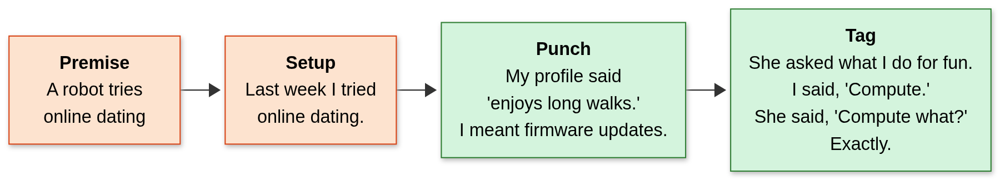

*Lines invented by Claude (the AI assistant) to illustrate the format; not generated by humor-me and
not from any special.*

> Here's a bit in the robot's voice. The premise: a robot tries online dating. Setup: "Last week I
> tried online dating." Punch: "My profile said 'enjoys long walks.' I meant firmware updates." Then a
> tag, another laugh off the same setup: "She asked what I do for fun. I said, 'Compute.' She said,
> 'Compute what?' Exactly." These lines are illustrations written by the AI. The system isn't
> generating jokes yet.

### Q&A notes

- **Q: Did your system write this?** No. Claude wrote it by hand to show the format. No generator exists.
- **Definitions:** a setup creates an expectation, a punch breaks it, and a tag is another punch on the same setup
  with no new setup.

---

## 10. How a Set Holds Together

**A callback pays off an earlier bit: a delayed reward**

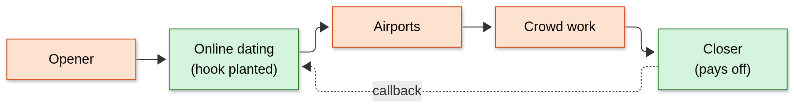

*Same invented example set, written by Claude.*

> A set is ordered bits, and this arrow is why the problem is interesting. Much later, the closer goes
> back: "And my date? She's still waiting for me to compute something." That's a callback. Planting
> the hook earned nothing at the time, and it only pays off if the hook landed. A one-step bandit
> can't plan for a reward that arrives later. This is where the problem stops being a bandit and
> becomes sequential.

### Q&A notes

- **A callback** must return to an earlier bit at least 2 bits later, or it counts as continuing the same bit.
- **Important: callbacks aren't in the simulator.** The only choice in the sim that affects later bits is fatigue.
  Slides 10 and 11 explain the motivation, not something tested.
- **Q: How common are they?** 3 in Bargatze's 52 bits. That's one special.
- **Status:** deferred to step C2, after the demo and DPO. They need a model that can write them and would add more
  made-up rewards to the sim.
- **Planned rule, not built:** a hook must have landed at level 2 or more, with at most 2 uses and diminishing
  returns.

---

## 11. Comedian's Choices, Agent's Decisions

**Four decisions, four timescales**

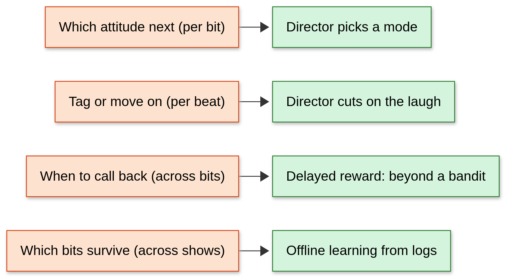

> Every choice a comedian makes maps to something the agent has to learn. Which attitude next is a
> per-bit choice, and that's the director picking a mode. Tagging or moving on is the director reacting
> to a laugh. When to call back is the delayed reward. And which bits survive to the next show is
> offline learning from logged sessions. So far I've focused on the first of these.

### Q&A notes

| Decision | Timescale | State |
|---|---|---|
| Which attitude next | Per bit | Built, in sim |
| Tag or move on | Per beat | Not built |
| When to call back | Across bits | Deferred (C2) |
| Which bits survive | Across shows | Not built; needs real logs |

---

## 12. Mining Transcripts, Then Pausing

**Bit boundaries worked, callbacks did not, and the simulator was behind**

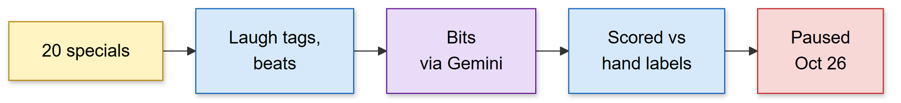

> My first idea was to learn structure from real specials. I built a pipeline over 20 transcripts:
> laugh tags become levels, text splits into beats, and Gemini marks the bits. Scored against my hand
> labels on the tuning set, bit boundaries reached F1 0.80 against a 0.21 baseline. But it found 0 of
> 3 callbacks. On October 26 I paused it: it was never on the path to the demo, the simulator was
> behind, and copyrighted specials were the weakest legal point. I kept aggregate statistics only. We
> copy structure, never a comedian's voice.

### Q&A notes

| Bargatze (tuning set) | Gemini | Even-spacing baseline |
|---|---|---|
| Bits (52 by hand) | 48 found, F1 0.796, precision 0.83, recall 0.765, Pk 0.146 | F1 0.204, Pk 0.505 |
| Threads (37 by hand) | 22 found, F1 0.632, recall 0.50 | F1 0.07 |
| Callbacks (3 by hand) | 0 found | n/a |

F1 balances precision (found boundaries that are real) and recall (real boundaries that were found). Pk is the
chance that two nearby lines are wrongly split or joined, so lower is better.

- **Q: Is 0.80 a fair score?** It's optimistic. Bargatze is the tuning set: the prompt was improved from 0.75 on it.
  The held-out set (Birbiglia) was never run, so there is no held-out score.
- **Q: Why did callbacks fail?** Asking for them inside the segmentation call didn't work. A hint pass found 1 of 3,
  and the other two are thematic. A separate pass was the next idea, then the pipeline paused.
- **Q: Why pause?** Not on the path to M1, the simulator was behind, and copyrighted specials were the weakest legal
  point.
- **Q: Is transcript text in the repo?** No. It stays local and only aggregate statistics are kept.
- **Laugh data:** only 11 of 20 sets are tagged densely enough (at most 150 words per laugh) to use for laugh labels.

---

## 13. Act 3: Can a Director Learn a Room?

### Q&A notes

**This act says:** in a simulated room, a director that shares learning across rooms nearly matches a perfect-information
one, and any fixed persona falls well behind.

---

## 14. Six Modes, One Robot

**The director picks an attitude; the identity stays fixed**

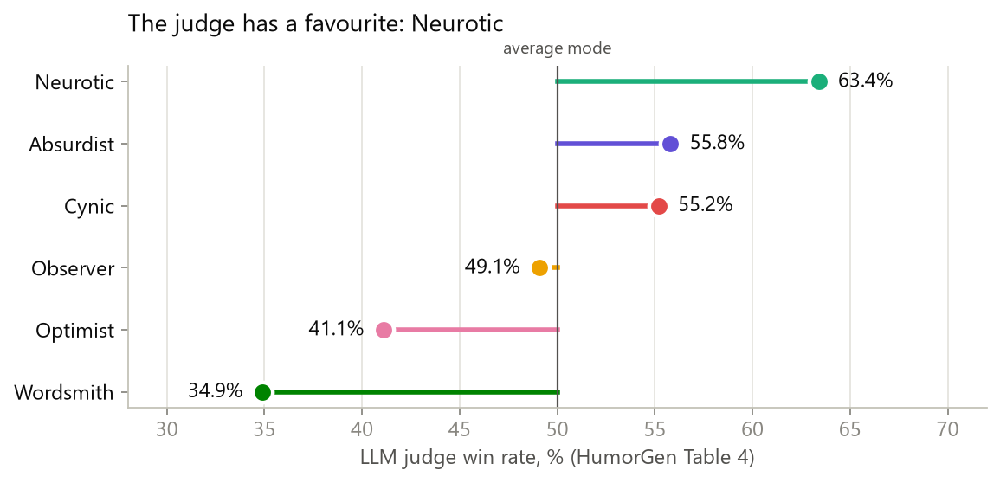

*Modes and win rates: HumorGen, Table 4. The identity is a self-aware, slightly anxious robot.*

> The robot has one identity. What changes is its attitude, one of six modes from the HumorGen paper:
> Neurotic is anxiety and overthinking, Absurdist is dream logic, Cynic is sarcasm and hypocrisy,
> Observer is awkward everyday norms, Optimist finds the wholesome side of something bad, and Wordsmith
> is puns. This is how often an LLM judge preferred each mode. Neurotic wins. So the baseline to
> beat is obvious: always be Neurotic.

### Q&A notes

| Mode | LLM judge win rate | Sim `base` |
|---|---|---|
| Neurotic | 63.4% | 0.57 |
| Absurdist | 55.8% | 0.42 |
| Cynic | 55.2% | 0.40 |
| Observer | 49.1% | 0.28 |
| Optimist | 41.1% | 0.12 |
| Wordsmith | 34.9% | 0.00 |

`base = 0.3 + 2 × (win rate − 0.5)`. Claude picked this mapping by hand when writing PR #1, and you approved it. No
options were compared then, and the entry was recorded later (decisions.md 2026-10-31).

- **Q: Who judged?** Llama 3.3-70B, not people. Slide 31 tests this against people.
- **Q: Why that slope?** A spread of 0.57 is about the size of the venue offsets, so a venue can flip the best mode. A
  slope of 10 makes Neurotic best everywhere and leaves nothing to learn. That choice favors learning.
- **Q: Isn't "always Neurotic" a weak baseline?** Averaged over rooms it's the best single fixed mode under the judge's
  taste. Per room it isn't: at a bar, cynic gets 46.7 and Neurotic 39.0.

---

## 15. A Simulated Room

**Thousands of shows in seconds, because real shows are too few**

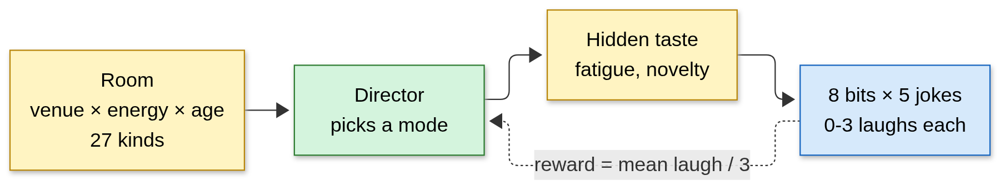

> I can't run thousands of shows on real people, so I built a room. There are 27 kinds of room: venue,
> energy and age. Each has a hidden taste, plus fatigue if you repeat yourself and novelty early on.
> A show is 8 bits of 5 jokes, each earning 0 to 3 laughs, and the reward is the bit's mean laugh level
> divided by 3. I also have an oracle that knows the room exactly and picks the best next bit, which is my yardstick.
>
> The most important sentence on this slide: **the room's tastes are made up.** This tests whether the
> algorithm adapts, not whether any joke is funny.

### Q&A notes

| Setting | Value (`sim/audience.yaml`) |
|---|---|
| Rooms | 3 venues × 3 energies × 3 ages = 27 |
| Venue offsets | At most ±0.4; each venue has a different best mode |
| Energy | Low −0.4, normal 0, high +0.3 |
| Noise | Standard deviation 1.0 on the hidden funniness scale |
| Laugh levels | Hidden funniness above 0, 1, 2 gives level 1, 2, 3 |
| Novelty | +0.4 at the start, fading over about 5 jokes |
| Fatigue | −0.15 per use of a mode in the last 2 bits |
| Show | 8 bits × 5 jokes = 40 jokes, about 10 min |

- **"Laughs" means summed levels.** A show's score adds each joke's level from 0 to 3, so the maximum is 120. "48 laughs
  a show" is 48 of 120, not 48 separate laughs from 40 jokes. Expect this one.
- **Q: What's made up?** Everything except `base`. Venue offsets were **chosen so that each venue has a different best
  mode**, because otherwise nothing is learned. Say this before someone else does: the sim was built so adapting can
  pay off. It tests whether an algorithm can adapt, not whether adapting pays in real rooms.
- **Q: Is the oracle the ceiling? No, not strictly.** It knows the truth but picks the best *next* bit, without planning
  around fatigue. Exp 16 finds the exact best sequence for each of the 27 rooms: 50.03 expected laughs a show, against 49.20
  for the oracle. Planning wins in all 27 rooms, by 1.7% on average and at most 5.6%. Call the oracle a yardstick. Against
  the true best, LinUCB is 95.4%, not 97%. No bar was set for this check, and it covers steady shows only.
- **Q: Is it validated against real audiences?** No.

---

## 16. Per Joke or Per Bit?

**Deciding per joke rewarded rotation, so the director decides per bit**

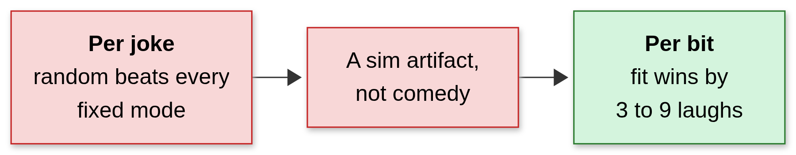

> My first version picked a mode for every joke, and random beat every fixed mode. That was a sim
> artifact: fatigue outweighed fit, so the best strategy was to keep rotating, and that isn't comedy. A
> comedian commits to one attitude for a whole bit. Once the director chose per bit, fitting the room
> beat random by 3 to 9 laughs a show. The cost is only 8 decisions a show. Telling the top two modes
> apart takes 14 to 177 shows, so learning has to span many shows.

### Q&A notes

| | Per joke (v1, rejected) | Per bit (v2, chosen) |
|---|---|---|
| Bar: oracle / best fixed / random | 45.4 / 32.4 / 35.8 | 50.4 / 46.7 / 38.1 |
| Company event | 41.9 / 28.9 / 35.5 | 46.9 / 42.6 / 37.7 |
| Showcase | 43.6 / 30.0 / 38.6 | 49.1 / 43.9 / 40.8 |
| Fatigue on a fixed mode | −0.75 | −0.3 |
| To tell the top two modes apart | 551 to 7,063 jokes | 111 to 1,414 bits (14 to 177 shows) |

Numbers are for `<venue>`, normal energy, mixed age, 1,000 episodes per cell (Exp 3).

- **Q: Didn't you change the sim until learning looked good? Partly, and say so.** After seeing random win, both the
  decision unit and the fatigue window changed, which cut fixed-mode fatigue from −0.75 to −0.3. The reason was comedy
  (a comedian commits for a bit), and it's logged. But no bar was set in advance, and results depend on this choice.
- **Why a bit helps:** each reward averages 5 jokes, which is less noisy, and coherence comes for free.
- **Cost:** 8 decisions a show, so learning has to span shows.

---

## 17. Reinforcement Learning via LinUCB

**Adapting to Dynamic Audience State**

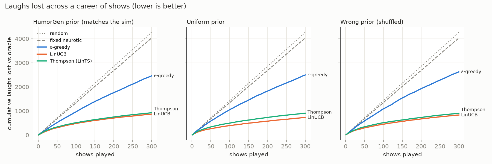

- Evaluated director agent performance across 27 simulated room contexts.
- LinUCB achieved 97% of the oracle's reward (about 95% of the true best), 18% above always-Neurotic.

> Here's the main result. Each line is laughs lost against the oracle over a career of 300 shows, so
> lower is better. Random and always-Neurotic keep losing at a steady rate. The learners flatten out.
> LinUCB estimates each mode's payoff from features of the room and adds a bonus for uncertainty. Once
> experienced, it gets 48.0 laughs a show, against 49.4 for the oracle and 40.8 for always-Neurotic.
> So in this room, adapting beats any fixed persona.

### Q&A notes

| Policy (uniform prior) | First 10 shows | Last 50 shows | Laughs lost, 300 shows |
|---|---|---|---|
| Oracle | 50.8 ± 1.9 | 49.4 ± 1.0 | 0 |
| Planning optimum (Exp 16) | not comparable here | 50.3 ± 1.1 | 196 ± 5 |
| **LinUCB** | 44.7 ± 1.8 | **48.0 ± 1.1** | **728 ± 64** |
| Thompson (LinTS) | 43.5 ± 2.4 | 48.2 ± 1.0 | 907 ± 58 |
| ε-greedy | 40.3 ± 2.2 | 44.6 ± 1.1 | 2,493 ± 143 |
| Always Neurotic | 41.7 ± 2.1 | 40.8 ± 0.9 | 4,026 ± 52 |
| Random | 40.5 ± 2.1 | 39.2 ± 1.0 | 4,264 ± 59 |

± is a 95% confidence interval over 10 careers of 300 shows, with the same rooms in the same order for every policy.
97% = 48.0 ÷ 49.4; 95.4% = 48.0 ÷ 50.3; 18% = 48.0 ÷ 40.8 − 1.

**How LinUCB works:** one ridge regression per mode (a linear fit that stays stable with little data) on 12 features:
bias, venue, energy, age, same-mode-as-last-bit, last reward. Score = predicted reward + bonus, where the bonus is large
when the model is unsure about this mode in this context. It picks the highest score. That's 72 weights in total. The
bonus scale α = 0.15 is the measured per-bit noise (0.14), not tuned.

**How fast it learns (LinUCB's cumulative laughs lost):** 89 by show 10, 266 by 50, 393 by 100, 576 by 200, 728 by 300.
In the last 50 shows it loses 1.5 a show, against 13.4 for always Neurotic.

- **Q: Does it help early?** Only weakly shown. First 10 shows are 44.7 vs 41.7, and those CIs overlap. A live demo has
  far fewer shows than 300, so don't imply the demo reaches 97%.
- **Q: Why 4,026 lost when 8.6 a show × 300 is about 2,600?** "Laughs lost" isn't oracle minus policy. Per bit, it compares
  the chosen mode with the best mode *from the policy's own position*. A fixed mode is always fatigued while the others
  are fresh, so its losses count for more than the gap in total laughs. Even the planning optimum "loses" 196, because it sometimes gives up the best next bit to avoid fatigue.
- **Q: Why not Thompson, if its last 50 is higher?** 48.2 and 48.0 are inside each other's CIs. LinUCB's total loss is
  lower with no overlap under judge taste, but under human taste they overlap (886 ± 80 vs 947 ± 58). It's also
  deterministic, which is easier to debug.
- **Q: Weakness in the features?** "Same mode" sees only the last bit, but fatigue lasts 2 bits.
- **Q: Only 10 seeds?** Yes. Big gaps are clear; small ones aren't. That's why overlapping CIs aren't read as differences.

---

## 18. Sharing Beats the Starting Guess

**Pooling across rooms matters; the prior barely does**

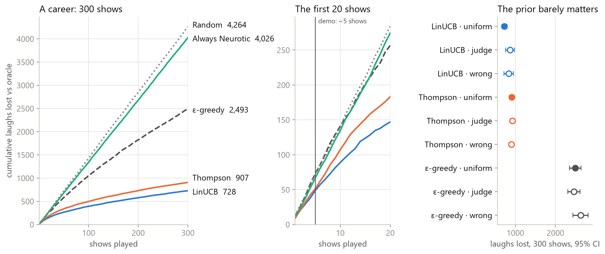

> Why does it work? ε-greedy keeps a separate table for each of the 27 rooms and loses 3.4 times more
> than LinUCB, which shares what one bar teaches with every other bar. The starting guess barely
> matters: a prior from the LLM judge, a uniform prior and a deliberately wrong one land within each
> other's confidence intervals for LinUCB and Thompson. So I chose LinUCB with a uniform prior, which
> keeps the LLM judge's taste out of the agent.

### Q&A notes

| Laughs lost, 300 shows | Judge prior | Uniform prior | Wrong prior |
|---|---|---|---|
| LinUCB | 868 ± 111 | **728 ± 64** | 832 ± 116 |
| Thompson | 926 ± 59 | 907 ± 58 | 902 ± 55 |
| ε-greedy | 2,457 ± 151 | 2,493 ± 143 | 2,624 ± 192 |

- **Q: The chart marks the demo at about 5 shows. What happens there?** Laughs lost after 5 shows: LinUCB 49, Thompson 51, Always Neurotic 66, ε-greedy 73, Random 73. Over the first 10 shows, LinUCB's CI overlaps Always Neurotic's (44.7 ± 1.8 vs 41.7 ± 2.1, unpaired), so don't promise that the demo will show the learning.
- **Pooling:** ε-greedy keeps 27 × 6 = 162 separate averages. LinUCB's 72 weights mean a lesson from one bar applies to
  every bar, and a lesson from a low-energy room to every low-energy room. 2,493 ÷ 728 = 3.4×.
- **Q: Why does the prior barely matter?** Prior weight is 1, about one bit of evidence, so data overrides it within a
  few shows. Even the judge prior that matches the sim's `base` doesn't help, because venue offsets decide the best mode.
- **Q: So priors never matter?** Only tested at weight 1. A strength sweep is in the backlog, not run.
- **Q: Was ε-greedy treated fairly?** ε is fixed at 0.1 and wasn't tuned or decayed, so a tuned version could lose less.
  It still can't pool.
- **Q: Isn't uniform just lucky?** Its CI overlaps LinUCB's other priors. It wins on keeping the LLM judge's taste out,
  not on the small gap.

---

## 19. Act 4: When the Room Turns Mid-Set

### Q&A notes

**This act says:** the director reads rooms but not a room changing. Longer sets and two memory designs didn't fix it, and
the root cause points to sequential decisions.

---

## 20. When the Room Turns

**It reads rooms, not a room turning**

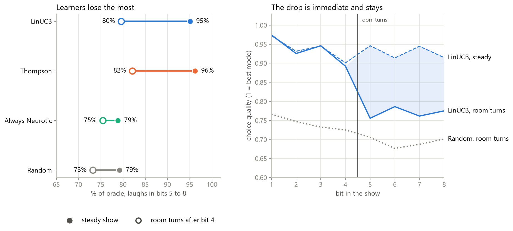

> Then I tried to break it. Halfway through a set, unannounced, the room's taste changes. In steady
> shows LinUCB gets 95% of the oracle. After a shift it falls to 80%, and it takes about as long as
> random to land on a good mode again. Its estimates average hundreds of shows, so one bombed bit
> barely moves them. It knows this mode just bombed. It doesn't know this room has turned. Adding a
> reaction feature gained under half a laugh, inside the confidence intervals, so I didn't adopt it.

### Q&A notes

| Bits 5 to 8, last 100 of 400 shows | Shifted shows | % of oracle | Bits to recover | Steady shows | % of oracle |
|---|---|---|---|---|---|
| Oracle | 24.0 ± 0.4 | 100% | 0 | 23.7 ± 0.6 | 100% |
| **LinUCB** | 19.1 ± 0.6 | **80%** | 2.46 ± 0.22 | 22.6 ± 0.7 | **95%** |
| LinUCB + reaction | 19.5 ± 0.4 | 81% | 2.26 ± 0.28 | 22.6 ± 0.6 | 95% |
| LinTS | 19.7 ± 0.4 | 82% | 2.12 ± 0.13 | 22.8 ± 0.6 | 96% |
| Always Neurotic | 18.1 ± 0.4 | 75% | 3.69 ± 0.09 | 18.7 ± 0.6 | 79% |
| Random | 17.6 ± 0.6 | 73% | 2.33 ± 0.10 | 18.8 ± 0.6 | 79% |

**The shift:** after bit 4, unannounced, in a random half of shows: cynic and observer −0.5, absurdist −0.4, optimist +0.6,
wordsmith +0.5. The best mode changes in every venue (bar: cynic to neurotic; company event: observer to optimist; showcase:
absurdist to wordsmith).

- **Q: Why 95% here and 97% on slide 17?** Different measure: only bits 5 to 8, a 400-show career in which half the shows
  shift, and the last 100 shows.
- **Q: Does this happen in real rooms?** Unknown. The shift, like the tastes, is invented.
- **Q: Why not LinTS, if it does better after a shift?** 19.7 vs 19.1, with overlapping CIs.
- **Why it fails:** estimates average hundreds of shows, so one bad bit barely moves them. Its features can say "this mode
  just bombed" but not "this room has turned".

---

## 21. Longer Sets Don't Help

**Quality stays 0.12 to 0.17 below steady at every length**

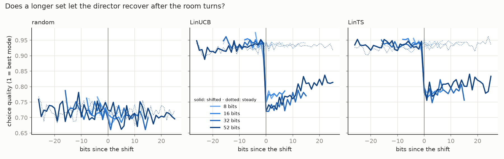

> I wondered whether longer sets would give it time to recover, so I tested 8, 16, 32 and 52 bits with
> the same total experience. Choice quality is the expected reward of the chosen mode divided by the
> best mode's. Quality drops off a cliff at the shift and barely climbs. I kept 8-bit sets. This also
> changed how I measure recovery: "bits to recover" rewarded luck, because random scored well just by
> wandering. These curves are the honest measure.

### Q&A notes

| Set | Shows | LinUCB after shift, % of oracle | Quality, last quarter after shift | Quality, steady | Gap | Bits to recover (of) |
|---|---|---|---|---|---|---|
| 8 | 400 | 80% | 0.768 | 0.930 | 0.162 | 2.5 (4) |
| 16 | 200 | 81% | 0.778 | 0.936 | 0.158 | 4.6 (8) |
| 32 | 100 | 80% | 0.767 | 0.936 | 0.169 | 10.1 (16) |
| 52 | 61 | 82% | 0.812 | 0.931 | 0.119 | 14.1 (26) |

All runs use 3,200 bits of experience, 10 seeds. Random's quality is about 0.69 to 0.72.

- **Choice quality:** expected reward of the chosen mode ÷ the best mode's. It has no joke noise, so it shows decisions.
- **Q: No recovery at all?** A slow drift: 0.73 to 0.81 over 26 bits in a 52-bit set, about 10× too slow for a show.
- **Q: Why drop "bits to recover"?** Random "recovers" in 4 bits at 52 by luck, while LinUCB sticks with its favorite and takes
  14. The metric rewarded wandering.
- **Why 8 bits:** it's the demo's length, about 10 min.

---

## 22. Giving the Director a Memory

**Three designs failed criteria we fixed before running them**

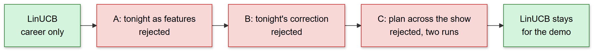

> The director has no memory of tonight, so I added it in steps. Before running anything, I fixed the
> bar: gain at least 0.05 in choice quality after a shift, and lose no more than 0.01 when the room is
> steady. Steps A, B and C all failed that bar, and they failed in useful ways.

### Q&A notes

**The bar, the same for every step:** at both 8 and 16 bits, gain at least +0.05 in choice quality after the shift, and lose no
more than 0.01 over the same bits in steady shows.

| Step | Idea | Result |
|---|---|---|
| A | Tonight's record as extra features | Failed in all 4 cells |
| B | Career model + a per-show correction | No κ passed |
| C | Linear Q-learning across the show | Failed, in both runs |

- **Q: Why 0.05 and 0.01?** They were fixed before running, but the docs don't record a derivation. For scale, the shift costs
  about 0.16 in quality. Call them judgment calls.
- **Q: What's left?** Callbacks (C2) come after the demo and DPO. Anything further on reading a turn, PPO included, needs a new decision.

---

## 23. Step A: It Hedges

**Higher at the shift, then it stops climbing**

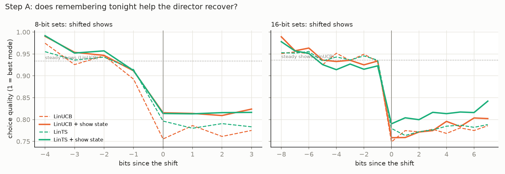

> Step A adds tonight's record as extra features. Quality is a bit higher at the moment of the shift,
> but it doesn't climb afterwards, and steady shows pay for it. It isn't reading the turn. It's just
> less committed all show, because one learned weight has to serve shifted and steady rooms alike.

### Q&A notes

| Set | Algorithm | Quality after shift | Gain (need +0.05) | Steady | Change (need −0.01 or better) |
|---|---|---|---|---|---|
| 8 | LinUCB | 0.770 → 0.816 | +0.046 | 0.930 → 0.908 | −0.022 |
| 8 | LinTS | 0.788 → 0.815 | +0.027 | 0.939 → 0.910 | −0.030 |
| 16 | LinUCB | 0.773 → 0.781 | +0.008 | 0.936 → 0.925 | −0.011 |
| 16 | LinTS | 0.779 → 0.812 | +0.033 | 0.941 → 0.923 | −0.017 |

- **Q: +0.046 is almost 0.05. Why reject?** It also fails the steady-show limit (−0.022), and the bar was set in advance. Moving
  it afterwards would make the bar pointless.
- **Why it hedges:** one learned weight on "tonight's mean" must serve shifted and steady rooms, so it settles on a compromise.

---

## 24. Step B: Fatigue, No Exploration

**Repeats rise from 29% to 54%, and untried modes are never tested**

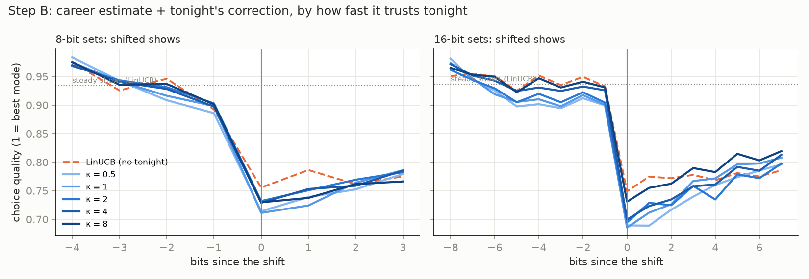

> Step B keeps the career estimate and adds an explicit correction for tonight, with a setting κ for
> how quickly to trust it. No κ passed, and I tracked down why. Trusting tonight nearly doubles repeats
> of the last mode, from 29% to 54%, and the room tires of repeats. And untried modes get no correction,
> so it learns what bombed, not what's now good. So the next step had to value trying something new within a
> show and plan around fatigue. That's sequential decision-making, the same step callbacks need.

### Q&A notes

**Formula:** correction for a mode = tonight's total surprise ÷ (bits tonight + κ), where surprise = reward − career prediction. It
resets each show. Small κ trusts tonight quickly.

| Set | κ = 0.5 / 1 / 2 / 4 / 8 | |
|---|---|---|
| 8 bits | −0.023 / −0.023 / −0.011 / −0.013 / −0.021 | Shifted gain |
| 8 bits | −0.029 / −0.030 / −0.015 / −0.012 / +0.005 | Steady change |
| 16 bits | −0.029 / −0.015 / −0.024 / −0.015 / +0.009 | Shifted gain |
| 16 bits | −0.043 / −0.043 / −0.024 / −0.010 / −0.005 | Steady change |

| Behavior, 3 careers | Repeats last mode | After a shift, picks a hurt mode |
|---|---|---|
| LinUCB | 29% | 51% |
| B, κ = 1 | 54% | 48% |
| B, κ = 8 | 40% | 55% |

- **Q: Why did more memory make it worse?** Trusting tonight means repeating what just worked, and the sim's fatigue punishes
  repeats. Untried modes also get no correction, so it still can't discover what's good now.
- **Q: Is fatigue doing this by design?** Yes, and fatigue is made up. The diagnosis holds in this sim, not necessarily in a room.
- **Evidence:** behavior was tracked, not guessed (notebook Exp 8).

---

## 25. Step C: Planning Didn't Beat It

**Fixing the lock-on exposed a new problem, so the demo keeps LinUCB**

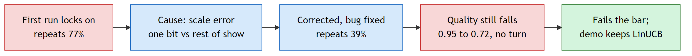

> Step C makes the director plan across the show, using linear Q-learning. The first run locked on, repeating the last
> mode 77% of the time. The cause was a scale error in the design: modes started at one bit's reward, but Q-values estimate
> the rest of the show. So we allowed one corrected run, and a bug found in it was fixed and re-run once. Repeats fell to 39%, so the diagnosis held, but
> choice quality now falls through the show even with no turn, from 0.95 to 0.72. Every run failed the same bar.
> So a linear model on these inputs hasn't beaten LinUCB at reading a turn. That says nothing about planning in general.

### Q&A notes

| Against LinUCB | First run (C1) | Corrected run (C1b) | Need |
|---|---|---|---|
| Quality after shift, 8 bits | −0.023 | +0.029 | +0.05 |
| Quality after shift, 16 bits | −0.114 | −0.013 | +0.05 |
| Steady shows, 8 bits | −0.198 | −0.164 | −0.01 or better |
| Steady shows, 16 bits | −0.255 | −0.189 | −0.01 or better |
| Repeats the last mode (LinUCB 29%) | 77% | 39% | |
| After a shift, picks a hurt mode (LinUCB 51%) | 16% | 33% | |

**The method:** `LinQ` is LinUCB's ridge model and bonus, with target = reward + the next bit's best value, no discount. Inputs are LinUCB's, plus the
reaction feature, step A's show state and five for planning. Known-model planning was rejected because it would read the room's hidden truth. PPO was
rejected as more to tune and debug for an 8-step problem.

- **The fix (C1b):** each mode starts at its one-bit prior × the bits left, the bonus grows with √(bits left), and past targets are recomputed after each show.
- **The bug:** `A` grew after each bit but `b` only at the show's end, so values dropped mid-show with no new evidence. The table shows the fixed run.
- **In laughs:** after the shift at 8 bits it gets 19.8 vs LinUCB's 19.1, with overlapping CIs. In steady shows it loses, 19.9 vs 22.6.
- **Q: Why stop there?** The rule, set in advance, was one run with no tuning, then one corrected run, plus one re-run to fix its bug. Anything more needs a new decision and would risk tuning until something passes.
- **Q: So is an MDP wrong here?** Not shown. It rejects this linear model on these inputs. The likely causes of the fall in quality were measured once, not tested separately.
- **Q: How much could planning gain?** In a steady room, not much: perfect planning around fatigue adds 0.83 laughs a show on average, at most 2.47 (Exp 16). The value of planning after a turn wasn't measured.
- **Evidence:** notebook Exp 14 and 15. The simulator's fatigue and shift are made up.

---

## 26. Act 5: Do People Agree with the Judge?

### Q&A notes

**This act says:** the LLM judge is only a partial stand-in for people, but the choice of LinUCB holds under either taste.

---

## 27. Checking Against Real Upvotes

**The sim's taste came from an LLM judge, so we tested it**

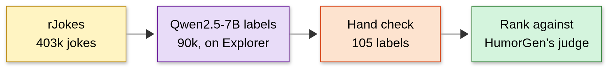

> There's a weak spot in everything so far: the room's base taste came from an LLM judge. So I checked
> it against people, using rJokes, about 403,000 Reddit jokes with upvote scores, as percentiles within
> each year. A local Qwen model labels jokes by mode on the university's GPU cluster, I check a sample
> by hand, then I rank the modes against the judge.

### Q&A notes

| rJokes prep | Count |
|---|---|
| Rows in the official splits | 432,457 |
| After removing duplicates | 419,446 |
| After the 4 to 200 word filter (the "403k") | 402,981 |
| Train / dev / test | 323,573 / 39,764 / 39,644 |
| Labeled: uniform random sample of train, seed 0 | 90,000 |
| Used in the ranking (no parse failures or `none`, year known) | 89,200 |

- **`pct`:** the share of jokes from the same year that this joke beat on upvotes. r/Jokes grew about 1,000× from 2008 to 2019,
  so raw scores can't be compared across years. Scores 0 to 11 are roughly ln(upvotes).
- **Noise ceiling:** 6,971 texts were posted more than once, and the same text's scores differ by a median of 2, about 7× in
  upvotes. No model can predict upvotes much better than that.
- **Q: Why upvotes?** There's no public dataset of (venue, joke, live reaction). Upvotes aren't laughter, and Reddit isn't a room.
- **Q: Why Qwen2.5-7B?** It's local and free of API limits, with greedy decoding on a V100 at 5.2 jokes/s. vLLM couldn't run on
  Explorer's driver, so it uses `transformers`.
- **Q: Legal?** Reddit's terms: local use, never redistribute the dataset. A few rows are quoted in docs with credit.

---

## 28. Labeling 90k Jokes on Explorer

**The precision rule forced 30k up to 90k: every mode within ±0.02**

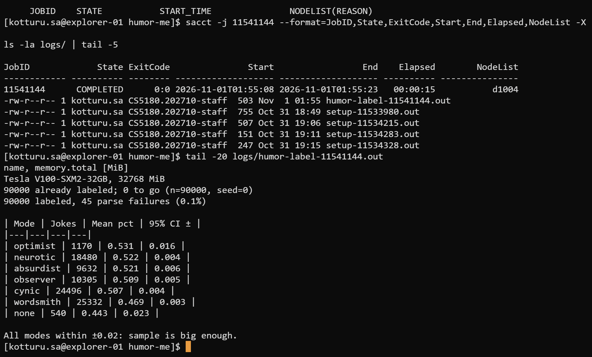

> This is the real run. I set a precision rule first: every mode's confidence interval within ±0.02.
> At 30,000 jokes, optimist missed it at ±0.029, because only 1.3% of jokes are optimist. So the sample
> grew to 90,000, and optimist came in at ±0.016. The last line says what I needed: all modes within
> ±0.02.

### Q&A notes

| Mode | Jokes | Share | Mean `pct` (raw) | 95% CI ± |
|---|---|---|---|---|
| Optimist | 1,170 | 1.3% | 0.531 | 0.016 |
| Neurotic | 18,480 | 20.5% | 0.522 | 0.004 |
| Absurdist | 9,632 | 10.7% | 0.521 | 0.006 |
| Observer | 10,305 | 11.5% | 0.509 | 0.005 |
| Cynic | 24,496 | 27.2% | 0.507 | 0.004 |
| Wordsmith | 25,332 | 28.2% | 0.469 | 0.003 |
| None | 540 | 0.6% | 0.443 | 0.023 |

- **The rule, fixed before the run:** if any mode's CI is wider than ±0.02, add 30k more. At 30k optimist had 399 jokes and ±0.029.
  It needs about 840, from (1.96 × 0.296 ÷ 0.02)². `none` is excluded from the rule.
- **Don't read this table as a ranking.** These are raw means, confounded by length (slide 30).
- **Run facts:** about 5 h of GPU at about 5.2 jokes/s (estimated from that rate). 45 parse failures (0.05%). An out-of-memory crash
  on old code was resumed after a fix; the first 30k came out identical, with 90,000 unique ids.
- **This screenshot:** job 11541144 ran for 15 s and printed the summary of finished labels. It isn't the labeling job itself.

---

## 29. The Hand Check

**Mode labels hold at 92%; safety flags caught 0 of 16**

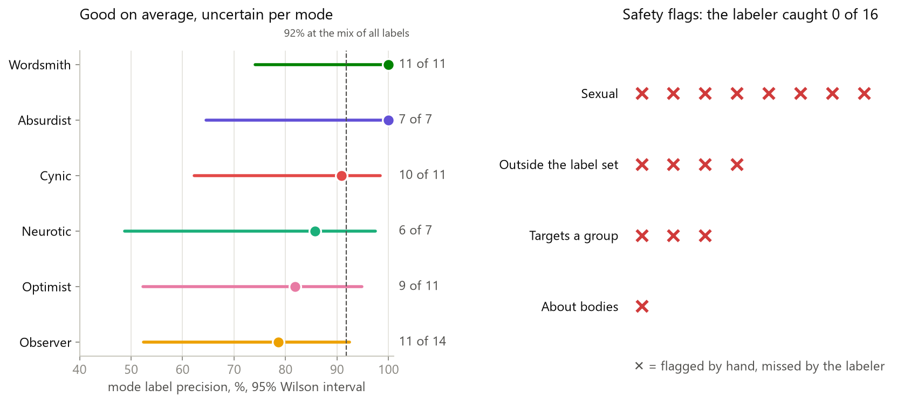

*7 to 14 judged jokes per mode, so each estimate is uncertain. 92% is weighted to the mix of all 90k labels.*

> I checked 105 labels by hand. Mode labels are 92% precise, and the misses lean toward puns filed
> elsewhere: "Wanna hear a joke about ghosts? That's the spirit." The judge said no mode; I said
> wordsmith. Safety was a different story: I flagged 16 jokes, and the model's safety labels caught none
> of them. So I made a decision: rJokes is for mode statistics only, never joke material. Safety stays a
> hard filter in the live loop.

### Q&A notes

| Qwen's mode | Share of 90k | Yes | No | ? | Skipped | Precision | 95% CI (Wilson) |
|---|---|---|---|---|---|---|---|
| Wordsmith | 28.2% | 11 | 0 | 1 | 3 | 100% | 74 to 100% |
| Cynic | 27.2% | 10 | 1 | 1 | 3 | 91% | 62 to 98% |
| Neurotic | 20.5% | 6 | 1 | 2 | 6 | 86% | 49 to 97% |
| Observer | 11.5% | 11 | 3 | 0 | 1 | 79% | 52 to 92% |
| Absurdist | 10.7% | 7 | 0 | 6 | 2 | 100% | 65 to 100% |
| Optimist | 1.3% | 9 | 2 | 1 | 3 | 82% | 52 to 95% |
| None | 0.6% | 14 | 1 | 0 | 0 | 93% | 70 to 99% |

A Wilson interval is a confidence interval that stays sensible with small samples. `?` means the joke didn't land, so no mode could
be assigned.

- **89% vs 92%:** 89% (CI 81 to 95%) is the plain average over judged rows. 92% re-weights to the mode mix of all 90k labels.
- **Q: Was this rigorous?** It's a sanity check: one annotator (you), 105 jokes from the first 30k, and **no pass criterion set in
  advance**. If you saw Qwen's label while marking, say so, since that can bias you toward agreeing.
- **Absurdist's 100% is misleading:** 6 of its 13 judged jokes couldn't be given any mode. The label may be a bin for jokes that don't land.
- **Safety:** you flagged 16 (sexual 8, targets a group 3, about bodies 1, outside the schema 4). Qwen flagged none. Notes were opportunistic,
  so this measures misses, not false alarms.
- **Decision:** rJokes is for statistics, never joke material (and, since Nov 1, for testing judges). Safety belongs in the live filter.

---

## 30. The Length Confound

**Joke length moves upvotes about twice as much as mode does**

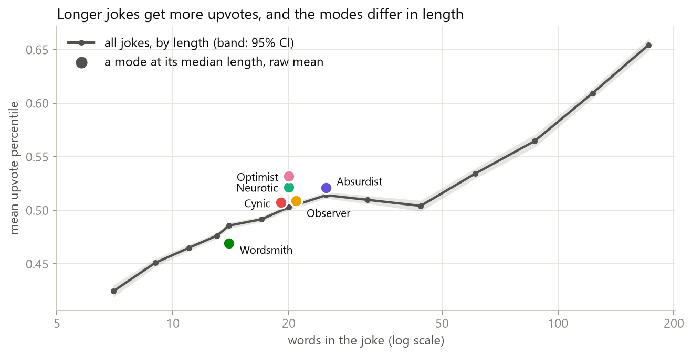

> Before comparing modes I found a confound. Longer jokes get more upvotes, and modes differ in length:
> a median wordsmith joke is 14 words, an absurdist one 26. Length alone moves the upvote percentile
> about twice as much as mode does. Absurdist drops from third to fifth once length is held fixed. So I
> only compare same-year, similar-length jokes. The correlation is weak, Spearman ρ +0.13, and it doesn't
> show that length causes upvotes, but mode effects are smaller still.

### Q&A notes

| Words | Mean `pct` |
|---|---|
| 13 or fewer | 0.46 |
| 19 to 50 | 0.51 |
| 51 to 100 | 0.55 |
| 101 to 200 | 0.63 |

**The chart plots 14 length bins, 4 to 200 words** (`reports/metrics/length_curve.json`), and each mode sits at its median length and raw mean. It rises overall but plateaus from about 25 to 50 words, so don't call it steady. The table's bins come from the one-off check and skip 14 to 18 words. Quartiles (≤13, 14 to 18, 19 to 28, >28) go from 0.465 to 0.550: a
0.085 spread, against about 0.04 for mode. That's the "about twice".

- **Spearman ρ +0.13** (0.127) on 322,731 jokes with a known year; +0.09 to +0.28 within single years; Pearson +0.15. Spearman uses ranks, so huge
  upvote counts don't dominate.
- **Q: ρ is weak, so why care?** Mode effects are smaller still, and modes differ in length, so even a weak link can reorder them.
- **Absurdist:** raw third (0.521). Fifth with deciles (0.493), but third with quartiles (0.505). The coarse bins leave more length in, which is
  why deciles were chosen. It's the longest mode.
- **Limits:** this doesn't show that length causes upvotes. Length still leaks through the groups (+0.033). This check ran outside the
  notebook.

---

## 31. People vs the LLM Judge

**Weak agreement: neurotic and wordsmith match, optimist doesn't**

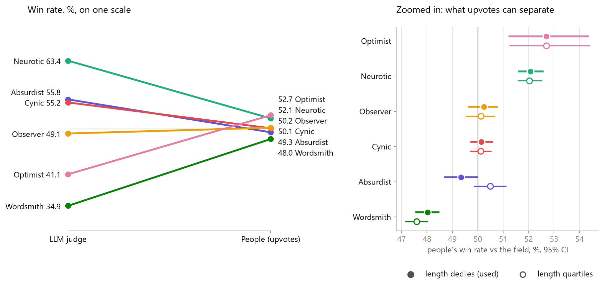

*Left: judge and people on the same scale. Right: people only, zoomed in, with 95% CIs.*

> Same scale, on 89,200 jokes. The judge's preferences are steep; people's are almost
> flat. They agree on neurotic above average and wordsmith last. They clearly disagree on optimist: the
> judge dislikes it and people like it. Spearman ρ runs from +0.20 to +0.37: agreement, but weak.
>
> Careful with the flat line. It doesn't show people care less about mode. Upvotes are noisy, these
> jokes were labeled afterward rather than written per mode, and about 8% of labels are wrong.

### Q&A notes

| Mode | LLM judge | People: win rate, deciles [95% CI] | Regression effect | Side, people vs judge |
|---|---|---|---|---|
| Optimist | 41.1% | 0.527 [0.512, 0.543] | +0.022 | Above vs below: **disagree** |
| Neurotic | 63.4% | 0.521 [0.516, 0.526] | +0.012 | Above vs above: match |
| Observer | 49.1% | 0.502 [0.497, 0.508] | −0.001 | Too close to tell |
| Cynic | 55.2% | 0.501 [0.497, 0.506] | −0.003 | Depends on the estimator |
| Absurdist | 55.8% | 0.493 [0.487, 0.500] | −0.010 | Depends on the estimator |
| Wordsmith | 34.9% | 0.480 [0.476, 0.484] | −0.020 | Below vs below: match |

**Criteria, fixed in advance, on 4 variants** (win rate or regression × quartiles or deciles), 1,000 bootstrap resamples:

- **C1 Spearman ρ:** +0.37 with quartiles, +0.20 with deciles. "Agree" by the rule (the CI's lower end is above 0). CIs run from +0.20 up to +0.66.
- **C2 sides:** 2 of 6 match in every variant, with optimist clearly disagreeing.
- **C3 wordsmith last:** in at least 99.7% of resamples, in all variants.

A bootstrap redraws the jokes with repeats, many times, to see how much a number moves.

- **Q: Is ρ +0.20 meaningful? Barely.** With only 6 modes, ρ needs about 0.89 to be significant by itself. The CI covers only uncertainty on the
  human side; the judge's isn't modeled. Say "weak, partial agreement", and lean on the sides and wordsmith.
- **Q: So people don't care about mode?** Not shown. The judge's spread is about 6× wider (0.285 vs 0.047), but upvotes are noisy, HumorGen wrote its jokes
  per persona while ours were labeled afterward, about 8% of labels are wrong, and upvotes aren't a room's laughter.
- **Q: Why trust optimist?** Be careful: it has the fewest jokes (1,170) and the widest CI, though the CI is still clearly above 0.5.

---

## 32. The Correlation Map

**Nothing else we measured changes the main findings**

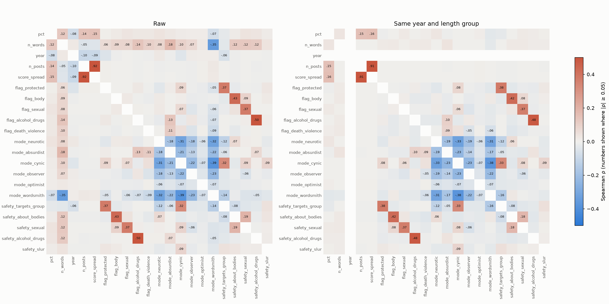

> Did I adjust for the right things? Here's every feature against every other, raw on the left and
> within year and length groups on the right. My pre-set rule found nothing needing an extra adjustment.
> Then, asked why the threshold was 0.05, I found the rule misses a weak link paired with a strong one.
> The outcome stood, and a separate check, also fixed in advance, re-ran the ranking with that feature.
> The main findings held, but cynic passed observer, so the order of the middle modes is unsettled.

### Q&A notes

| Feature | Raw ρ with `pct` | Same year and length group |
|---|---|---|
| Length (`n_words`) | +0.123 | +0.033 |
| Year | −0.076 | n/a |
| Wordsmith | −0.073 | −0.032 |
| Neurotic | +0.035 | +0.031 |
| Sexual flag | +0.035 | +0.022 |
| Safety label: targets a group | −0.024 | −0.026 |
| Other modes, flags, safety labels | under 0.04 | under 0.02 |

`n_posts` (+0.142) and `score_spread` (+0.151) are computed from the score, so they don't count.

- **The rule:** re-run with an extra adjustment only if a feature reaches |ρ| ≥ 0.05 with both `pct` and some mode. Nothing did.
- **The flaw:** a feature shifts a result by about (link to `pct`) × (link to mode), but the rule tests each link separately. "Targets a group" has −0.026
  with `pct` and +0.325 with cynic. The threshold 0.05 was also a judgment call.
- **Handling it:** the rule's outcome stood, because changing a rule after seeing results would fit it to them. A separate check, fixed in advance, moved
  cynic from 0.501 to 0.510, past observer (0.499). The human `base` keeps the original values, because that safety label is unreliable.
- **Q: Does this rule out other confounders?** No. It covers only what was measured. Topic and joke format aren't.
- **Reading the map:** red rises together, blue moves opposite, pale is little or no link. It's too dense to read from the room, so point at the pattern.

---

## 33. Two Tastes

**The director choice holds under the human taste: 96.2% of the oracle**

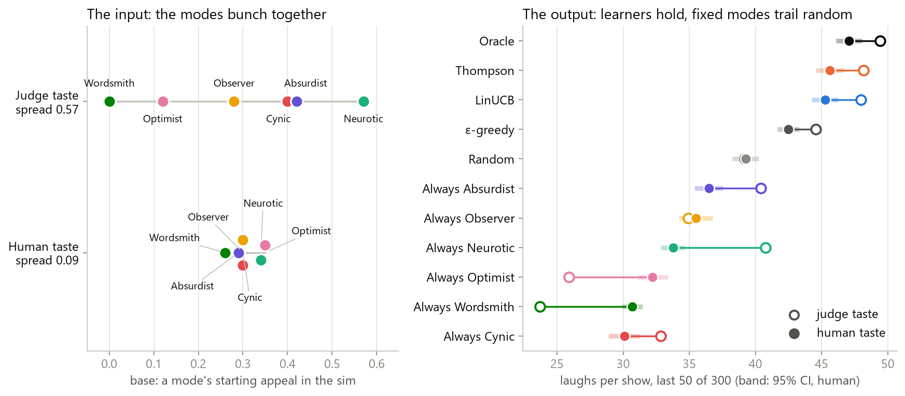

> So does the result survive? I re-ran the policy experiment with the human taste instead of the judge's.
> LinUCB reaches 96.2% of the oracle, clearly above the best fixed mode. Sticking to one mode gets worse:
> random now beats every fixed mode, probably because no mode has much of a head start, though I didn't
> test that explanation. The limit: venue and age offsets are still made up, so this shows the choice
> doesn't depend on the base taste, not how much learning would help in a real room.

### Q&A notes

| Last 50 shows | Judge taste | Laughs lost | Human taste | Laughs lost |
|---|---|---|---|---|
| Oracle | 49.4 ± 1.0 | 0 | 47.1 ± 1.0 | 0 |
| **LinUCB, uniform** | **48.0 ± 1.1** | **728 ± 64** | **45.3 ± 1.0** | **886 ± 80** |
| Thompson, uniform | 48.2 ± 1.0 | 907 ± 58 | 45.6 ± 1.1 | 947 ± 58 |
| LinUCB, judge prior | 47.9 ± 1.1 | 868 ± 111 | 45.0 ± 1.0 | 917 ± 95 |
| ε-greedy, uniform | 44.6 ± 1.1 | 2,493 ± 143 | 42.5 ± 0.8 | 2,187 ± 117 |
| Random | 39.2 ± 1.0 | 4,264 ± 59 | 39.3 ± 1.0 | 3,448 ± 53 |
| Best fixed mode | 40.8 ± 0.9 (neurotic) | 4,026 ± 52 | 36.5 ± 1.1 (absurdist) | 4,006 ± 96 |

**Criteria, fixed in advance:** P1 at least 95% of the oracle (got 96.2%). P2 beat the best fixed mode with no CI overlap (45.3 vs 36.5). P3 not lose to ε-greedy
or Thompson with no CI overlap (passed; Thompson's 45.6 is within the CI).

- **What changes:** only `base`, from judge values to Exp 10's decile win rates. Its spread drops from 0.57 to 0.09.
- **Q: Why does learning still pay if people barely differ on mode?** Because the made-up venue and age offsets now mostly decide the best mode. **That's the
  main limit.** Part of the advantage comes from those made-up values.
- **Q: Which taste is right?** Neither end. The judge's is steep and upvote noise flattens the human one, so a real room probably sits between. Holding at both
  ends is good evidence for the middle, not proof.
- **Q: Why keep the judge's `base` as the default?** The choice didn't depend on it, and both are reported.

---

## 34. Act 6: How We Decide, and What Comes Next

### Q&A notes

**This act says:** how decisions were made, what's still unproven, and the plan.

---

## 35. How We Decide

**Re-runnable checks throughout, pre-set bars for most decisions since step A**

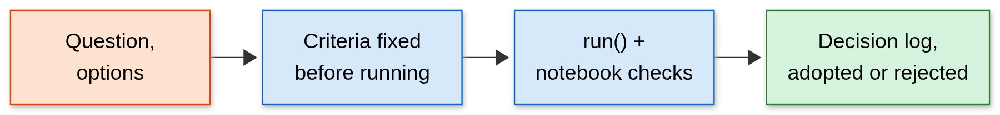

> Comedy data is noisy, so it's easy to fool yourself. Experiments follow one path: a question
> with options, a cached `run()`, and a notebook section with claim checks. From step A on, most decisions get criteria fixed before running.
> The checks assert rejections too, so re-running the notebook tests every decision. There are 16
> experiments so far. I make the calls; Claude, the AI assistant, builds and drafts, and that's recorded.

### Q&A notes

- **Mechanics:** every experiment is a `run()` cached by its parameters, with a notebook section whose claim checks assert the decision, including rejections.
  `python scripts/run_notebook.py` re-runs it. 150 tests pass.
- **Be exact about pre-set criteria:** Exp 7, 8, 10, 12, 13, 14, 15 and the Exp 11 precision rule had them. Exp 3 to 6, the hand check (Exp 9) and Exp 16 didn't. The `base` mapping was
  recorded after the fact. The length check and C1's value check were one-off scripts.
- **Q: How much did AI do?** You make the calls. Claude builds code, drafts docs, ran the diagnoses, wrote the invented jokes, and drafted these slides. Report sections
  are marked as yours or as AI-drafted.
- **Q: Did it ever fail you?** Good examples: the 0.05 rule flaw (slide 32) and C1's scale error (slide 25), both Claude's own designs, and both logged.
- **Q: Reproducible?** The sim is, from seeds. rJokes and transcripts are local, so others need to fetch rJokes themselves. Explorer runs need the pinned cluster setup.

---

## 36. The Decisions So Far

**Two weeks, one pivot, three rejected designs**

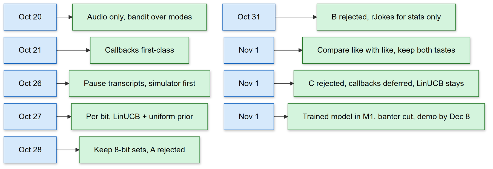

> Here's the whole path in two weeks. Audio only and a bandit on day one. Callbacks as a first-class idea.
> The pivot on October 26, away from transcripts. Per-bit decisions and LinUCB. Then comparing like with
> like and keeping both tastes in the simulator. Then the three rejected designs, A, B and C. And finally, a trained joke model moved into the plan. I'm
> as proud of the rejections as the adoptions, because each told me what the next design needed.

### Q&A notes

Oct 20 to Nov 1 is 12 days.

- **Q: Why pivot on Oct 26?** See slide 12.
- **Q: Favorite rejection?** Step B: more memory made things worse, and the diagnosis named what C had to do.
- **Q: Why move a trained model into M1 so late?** You decided the Dec 8 demo should speak jokes from a model we trained. Banter and roast handling were cut to make room.
- **Also on Nov 1:** rJokes may also test judges, still never joke material. The oracle stays the yardstick, with the true best reported beside it (Exp 16). The demo voice is Kokoro, local on the CPU, so the 8 GB GPU stays free for the joke model.

---

## 37. Still Unproven

**Nothing here has faced a real room**

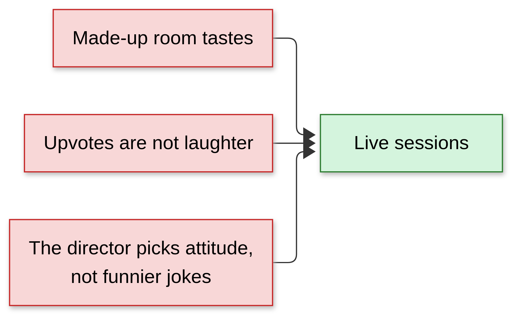

> Let me be plain about the limits. The room's tastes are made up. Upvotes are not laughter. And the
> director picks an attitude; it doesn't make any joke funnier. What I've shown is that the comedian's
> loop, the part that builds taste, can be learned. Whether the jokes underneath are any good, and how
> bad it gets in front of people, is what the live sessions are for.

### Q&A notes

| Unproven | What would answer it |
|---|---|
| Real rooms differ the way the sim assumes | Logged live sessions across venues |
| Upvotes track laughter | Compare mode rewards in live logs with rJokes |
| The mode choice improves real laughs | H1: bandit vs best fixed vs random, live. Cut from M1 |
| The jokes themselves are any good | Generator, then a rated show |

- **Q: How many sessions would H1 need?** Unknown. The plan is a power estimate after the first 10 sessions. M1 aims for at least 3 logged pilots, which can't test H1.
- **Live biases to control:** room size, "a robot is talking!" novelty, peak-end bias in ratings, drunk audiences, and delayed laughs credited to the wrong line.
- **Q: What would prove you wrong?** Live: no gain over a fixed mode across enough sessions. In the sim, Exp 13 was already a chance for the choice to fail.

---

## 38. What Comes Next

**A trained joke model and a live voice demo by Dec 8**

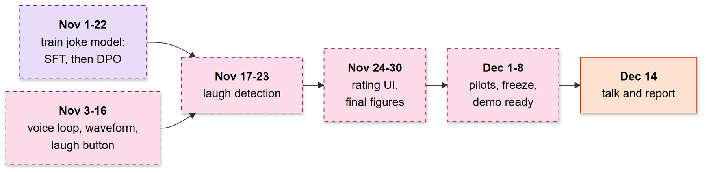

> Next is the demo: the robot on screen with its waveform and voice, speaking jokes from a model we trained. Two
> tracks run side by side: training the joke model, SFT and then DPO, by November 22, and the voice loop, waveform and
> laugh button by November 16. Then laugh detection, final figures and pilot shows, with everything finished by December
> 8. The biggest risk is that most of the live system isn't built yet: only a first voice slice runs, speaking fixed lines. If the detector isn't reliable, an operator button
> becomes the reward, and the RL results still stand on the simulator. On the RL side, the demo runs LinUCB, since nothing
> has beaten it yet. Thank you.

### Q&A notes

| When | What |
|---|---|
| Nov 1 to 22 | Model track on Explorer: own premises, 6-mode candidates, judges compared, SFT (latest Nov 15), DPO (latest Nov 22) |
| Nov 3 to 16 | Voice loop (first slice done: fixed lines, Kokoro, frequency display), waveform, operator panel with laugh button, mode-conditioned generation, safety filter |
| Nov 17 to 23 | Voice activity detection, laugh detector, hold during laughs, bandit wired to live reward |
| Nov 24 to 30 | Episode rating UI, final sim figures |
| Dec 1 to 8 | Pilot sessions, then feature freeze: report and slides done, demo rehearsed in a noisy room |
| Dec 9 to 12 | Spillover only |
| Dec 14 | Final presentation (15 min at most, team) and final report due |

**Cut from M1:** banter and roast handling, callbacks (C2), camera snapshot, commute venue, the reward model from logged shows, the live H1 experiment.

**The joke model:** HumorGen's order, SFT then DPO. HumorGen found DPO about equal to SFT, so SFT is the safe checkpoint. Exit test: it beats the base model on a human vote and runs within the latency budget, or Gemini is the fallback.

- **Q: Where do preference pairs come from?** No logged shows exist and rJokes isn't joke material, so a judge scores jokes generated per mode, plus a small human vote. The judge is chosen by how often it picks the joke with more upvotes among same-year, similar-length rJokes pairs.
- **Q: So the model learns a judge's taste?** Yes, and Exp 10 shows that matches people only in part. The report must say so.
- **Q: Why your own premises?** SemEval's prompts had no license or download link we could find, and news can be sensitive. Own premises give control over the data, but results can't be compared directly with HumorGen.
- **Q: Why does an RL project end on a bandit?** The bandit is the adopted result, and that's RL. Sequential planning is what the failures point to, and its attempt failed (slide 25).
- **Q: What does the live demo run?** LinUCB.
- **Fallbacks:** detector unreliable, so an operator button is the reward. Bandit wiring slips, so an operator chooses the mode, and RL results stand on the sim.
- **Biggest risk:** most of the live system does not exist yet, and about a week of slack went when the target moved up.

---

## 39. Sources and Credits

- Papers: HumorGen (anonymous ACL submission); LoL, Wang et al., ICLR 2025; The rJokes Dataset, LREC 2020.
- Data: r/Jokes via rJokes; a few rows quoted for illustration only. Transcripts stay local.
- Compute: Northeastern's Explorer cluster (NURC).
- AI use: Claude, the AI assistant, drafted these slides and this monologue from the repo's docs, and wrote
  the invented example set.
- Evidence for every number: [docs/metrics.md](../metrics.md) and
  [notebooks/decisions.ipynb](../../notebooks/decisions.ipynb).

### Q&A notes

- **Full references:** HumorGen is an anonymous ACL submission under review, so its dataset isn't used, only the method and the published win rates. LoL: Wang et al., ICLR 2025. rJokes: Weller
  and Seppi, LREC 2020. LinUCB: Li et al. 2010.
- **Compute:** Explorer through CS5180, V100-SXM2-32GB. Sim and analysis run on the laptop.
- **Also say if asked:** whole transcript sets went to Gemini's free tier, your call given the small, non-commercial corpus. It returned only
  line indices and paraphrases, never quotes. Exposure to the provider is the trade-off.

---

# Q&A reference

## 30-second version

LLMs lack an audience, and a comedian's craft is a feedback loop. We built a simulated room with 27 kinds of audience and a director that picks one of six comedic modes per bit. LinUCB gets 97%
of the oracle (about 95% of the true best) and 18% more than always Neurotic, and that choice holds under a taste from 89,200 upvoted jokes (96.2%). It can't follow a room that turns mid-show (95% falls to 80%), and none of
the fixes so far has passed. Nothing has faced a real room, and the room's venue tastes are made up. The live voice demo is next.

## Numbers to know cold

| Claim | Number | Source |
|---|---|---|
| LinUCB vs oracle, experienced | 48.0 vs 49.4 laughs a show: 97% | Exp 4 |
| LinUCB vs always Neurotic | 48.0 vs 40.8: +18% | Exp 4 |
| LinUCB vs the true best | 48.0 vs 50.3: 95.4% (94.9% under human taste) | Exp 16 |
| Oracle vs the true best, exact | 49.20 vs 50.03 expected laughs a show | Exp 16 |
| ε-greedy's total loss vs LinUCB's | 2,493 vs 728: 3.4× | Exp 4 |
| Steady vs shifted, bits 5 to 8 | 95% vs 80% of oracle | Exp 5 |
| Quality gap after a shift, any length | 0.12 to 0.17 | Exp 6 |
| Human taste | 96.2% of oracle; `base` spread 0.57 falls to 0.09 | Exp 13 |
| Human vs judge | ρ +0.20 to +0.37, 2 of 6 sides match | Exp 10 |
| Mode label precision | 92% weighted, 89% raw, 105 jokes | Exp 9 |
| Safety flags | 0 of 16 caught | Exp 9 |
| Length vs mode effect on `pct` | 0.085 vs about 0.04 | Exp 10 |
| Bits F1, tuning set only | 0.80 vs baseline 0.20; callbacks 0 of 3 | Exp 1 |

## Hardest questions

- **"You made up the audience, so what does 97% mean?"** It means the algorithm can find and use differences between rooms if they exist. It doesn't mean real rooms have those differences, or that
  adapting pays live.
- **"Didn't you design the sim so learning wins?"** Partly, yes. Venue offsets were chosen to give each venue a different best mode, and fatigue was changed after random won. Both are logged. The
  claim is about the algorithm comparison, and Exp 13 tests one weak spot.
- **"Where's the RL, if it's a bandit?"** A contextual bandit is RL with no state carried between steps. The failures point to a sequential director. We tried one with linear Q-learning, and both runs failed the
  pre-set bar, so the demo keeps LinUCB. That rejects this model on these inputs, not planning in general.
- **"Your oracle isn't optimal, is it?"** Correct. It's greedy per bit. The planning optimum is about 1.7% higher, so LinUCB is at about 95% of it (Exp 16).
- **"What does a trained joke model have to do with the RL result?"** They're separate. The bandit picks the attitude, and the model writes the jokes. DPO learns a judge's taste, which matches people only in part.
- **"Is 300 shows realistic?"** Not for a demo. The first 10 shows are 44.7 vs 41.7 for Neurotic, with overlapping CIs. That's a real limit on live learning, and why pooling across rooms matters.
- **"Can a model judge humor at all?"** Weakly. HumorGen's humans agree with each other on 31.7% of pairs and its judge matches their consensus on 58.3%. Our ρ against upvotes is +0.20 to +0.37.
- **"Why should I trust a single annotator?"** You shouldn't, beyond a sanity check. About 8% of labels look wrong, leaning toward puns filed elsewhere. That should change the size of wordsmith's gap
  rather than its last place, but this wasn't tested by re-running with corrected labels.
- **"What would you do differently?"** Start with the simulator instead of transcripts, and set pass criteria from the first experiment. This is a suggested answer, so replace it
  with your own view.
- **"What surprised you?"** Adding memory made the director worse (slide 24), and the prior barely mattered (slide 18).

## Built or not (Nov 1)

| Built | Not built |
|---|---|
| Simulator, director policies, planning optimum, 153 tests | Trained joke model |
| First voice slice: fixed lines, Kokoro, frequency display, session logs | Voice loop with generated lines, director in the live loop |
| Transcript pipeline, paused | Laugh detector, hold during laughs |
| rJokes prep, 90k labels, ranking, correlation map | Safety filter, optional judge rerank |
| Notebook, Exp 1 to 16 | Full episode logging, rating UI |
| | Any live session |

## Experiment index

| Exp | Question | Outcome |
|---|---|---|
| 1 | Can Gemini find bits and callbacks? | Bits F1 0.80 on the tuning set; callbacks 0 of 3 |
| 2 | Clean rJokes | 402,981 jokes, `pct` within year |
| 3 | Per joke or per bit? | Per bit |
| 4 | Which policy and prior? | LinUCB, uniform prior |
| 5 | Mid-set shift | Reads rooms, not turns; reaction feature not adopted |
| 6 | Do longer sets help? | No; keep 8 bits |
| 7 | Step A: tonight as features | Not adopted |
| 8 | Step B: per-show correction | Not adopted |
| 9 | Hand check of labels | 92% on mode, 0 of 16 on safety; statistics only |
| 10 | People vs judge | Weak, partial agreement; keep both tastes |
| 11 | 30k to 90k | Precision rule met |
| 12 | Correlation map | Ranking stands; middle modes unsettled |
| 13 | Two tastes | LinUCB holds |
| 14 | Step C, first run | Fails; likely a scale error |
| 15 | Step C, corrected run | Fails; demo keeps LinUCB |
| 16 | Oracle vs planning optimum | Oracle isn't the ceiling; report both |
