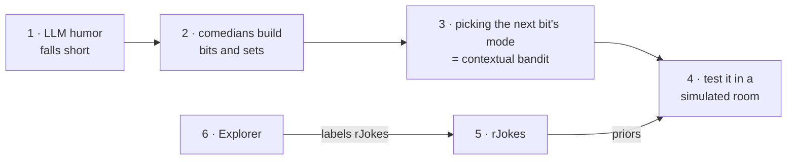

# Project wiki

Concepts explored while building humor-me. Every page opens with **where the topic fits in the
project and where it's used**, then explains it, then lists outside resources for going deeper.
Pages are written as we build, so they also record what we learned and why we chose what we did.

Transcript-pipeline concepts (PDF extraction, laugh labels, TextTiling, segmentation scoring)
live in the [pipeline wiki](../../pipeline/wiki/README.md).

**Start with the [Glossary](glossary.md)**: what a bit, a mode, a prior or regret means in this repo.

## Reading order

The pages follow the report's story: why LLM jokes fall short → how comedians build a set →
how that maps to a learning problem → how we test it.

| # | Page | Fits in | One-line summary |
|---|---|---|---|
| 1 | [LLM humor vs stand-up](llm-humor-vs-standup.md) | Motivation, generator | Why "be funny" prompts give average jokes, and what's missing from them |
| 2 | [Stand-up structure](standup-structure.md) | Set planner, bit writer, director | Premise → setup/punch → tags → bits → sets → callbacks |
| 3 | [Contextual bandits](contextual-bandits.md) | Director (mode choice) | Explore vs exploit with context: ε-greedy, UCB/LinUCB, Thompson, regret |
| 4 | [Simulated audience](simulated-audience.md) | RL evaluation (M1) | A gym-style room that laughs 0–3, and what its first metrics showed |
| 5 | [rJokes dataset](rjokes-dataset.md) | Sim priors, joke scorer | 400k scored Reddit jokes: what they can and can't tell us |
| 6 | [Explorer HPC](explorer-hpc.md) | Offline GPU jobs | Slurm, OOD and course-partition limits on Northeastern's cluster |
| – | [Glossary](glossary.md) | Everywhere | Shared vocabulary: comedy units, agent roles, learning and evaluation terms |

## Adding a page

New term in a PR → add it to the [Glossary](glossary.md) in the same PR.

Template: `# Title` → `**Where it fits / Used in**` → concept sections → `## In this project`
→ `## Further reading` (links checked to be live when added; say what each link is good for).
