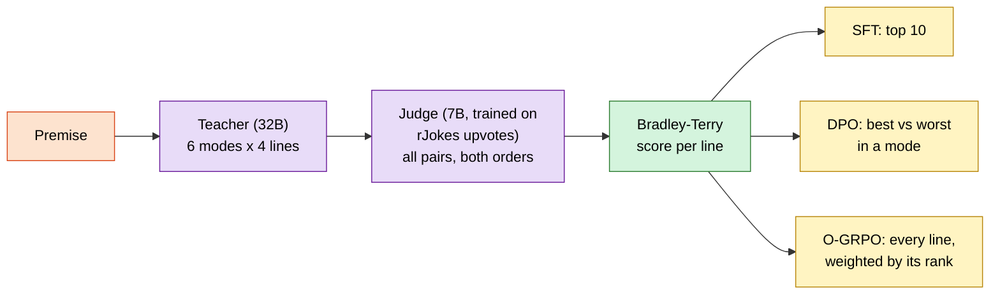

# Training the joke model: SFT, DPO and offline GRPO

**Where it fits:** the model track (docs/status.md "Next steps" 1). The joke model is the 7B that writes a line for
a premise in the mode the director picks; it speaks in the Dec 8 demo. Build plan and runbook:
[plans/sft-dpo-ogrpo.md](../plans/sft-dpo-ogrpo.md). Code: `explorer/`. Terms: [glossary](glossary.md) (SFT, DPO,
O-GRPO, teacher / student, judge gate).

## The idea in one picture

**Summary:** a big model writes many candidates, a judge ranks them once, and the same ranking feeds three ways of
training the small model.

## The three ways of training

**Summary:** all three learn from the same ranked lines; they differ in which lines they use and how.

| Method | Uses | Loss, in words | What it can't do |
|---|---|---|---|
| **SFT** | The top 10 lines per premise | Make these lines more likely | Learn what to avoid; it never sees a bad line |
| **DPO** | Pairs: a good and a bad line for the same prompt | Raise the good line's likelihood relative to the bad one, measured against the SFT model (the reference), so the model can't drift far | Use more than two lines per prompt |
| **O-GRPO** | Every line, with an advantage: how far its score sits above the premise's average | SFT on all lines, each weighted by softmax(advantage), so better lines count more | Push weak lines down: every weight is positive, so a weak line is learned a little, not avoided |

"Offline" is the point of O-GRPO: real GRPO samples new lines during training and scores them on the spot, which
for humor needs a judge call per pair inside the loop. HumorGen ranks the pool once instead (their Appendix H).

## What HumorGen found, and what we expect

**Summary:** with well-curated SFT data, the alignment step added little.

- DPO ≈ SFT on both of their judges (CIs overlap); O-GRPO below both. Their explanation: most lines get a negative
  advantage because a few strong lines pull the mean up. Rank-normalizing the advantages made it worse.
- So the honest expectation here is SFT better than the base model, DPO vs SFT inconclusive. A tie replicates them.
- Our evaluation uses a different judge (Qwen2.5-32B) from the one that built the sets, so a model can't win just
  by fitting the training judge.

## Choices that are ours, not HumorGen's

- **The mode is in the prompt**, because the director chooses it. So a DPO pair is two lines of the same mode;
  HumorGen's pairs (any top-5 line vs any bottom-5 line) would mix modes under one mode's prompt.
- **The judge is trained, not just prompted** (LoL's idea): a 7B taught to answer A/B on Reddit upvote pairs. It
  must pass a gate first: beat chance and the untrained model on held-out pairs.
- **Training lines pass the show's safety rules** under the strictest (teens) rules.

## Going deeper

- HumorGen (Ajayi and Mitra, 2026), Sections 4–5 and Appendix H: `references/md/2604-09629v3.md`.
- LoL (Wang et al., ICLR 2025), Section 2.2 and Appendix A.1, the frozen judge: `references/md/2024.md`.
- DPO: Rafailov et al. 2023; the study guide's section 2.9.
- GRPO: Shao et al. 2024 (DeepSeekMath), the group-relative advantage that O-GRPO borrows.
