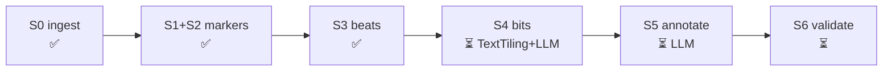

# pipeline/

Turns locally stored stand-up transcript PDFs into **structure and reward data**: beats
labeled with audience reactions, bits (one premise each) and whole-set sequences. These feed
the laugh predictor (reward model), the RL planner's demonstrations and the simulated audience.

Full spec with schemas: [docs/pipeline.md](../docs/pipeline.md).
Concepts behind each stage: [wiki/](wiki/README.md).

## Stages



| Stage | Module | Status | Input | Output | Concepts |
|---|---|---|---|---|---|
| S0 | `pipeline.ingest` | built | `data/raw/*.pdf`, `data/body_overrides.yaml` | `data/interim/<set>.body.txt`, `.meta.json` | [PDF extraction](wiki/pdf-extraction.md) |
| S1+S2 | `pipeline.markers` | built | `.body.txt`, `data/markers.yaml` | `.clean.txt`, `.events.jsonl`, meta update | [Reaction markers & laugh labels](wiki/laugh-labels.md) |
| S3 | `pipeline.beats` | built | `.clean.txt`, `.events.jsonl`, `datasets.json` | `data/processed/<dataset>/beats.jsonl`, `.labeled.txt` (debug view) | [Beats, bits, sets](wiki/beats-bits-sets.md) |
| S4+S5 | `pipeline.bits` | built (Gemini, 1 call/set) | `lines.jsonl`, `backend/.env` | `data/processed/<dataset>/bits.jsonl`, cache `data/interim/<set>.bits.raw.json` | [Beats, bits, sets](wiki/beats-bits-sets.md) · [TextTiling](wiki/texttiling.md) (deferred baseline) |
| S5 | `pipeline.annotate` | planned | bits | annotated `bits.jsonl`, `sets.jsonl` | [Beats, bits, sets](wiki/beats-bits-sets.md) |
| S6 | `pipeline.validate` | built | `bits.jsonl` + `data/labels/<set>.yaml` | Pk, WindowDiff, boundary F1 (±2 lines), callback P/R vs an even-spacing baseline → `data/processed/eval_bits.json` | [Segmentation evaluation](wiki/segmentation-evaluation.md) |
| guard | *(planned)* | planned | `.clean.txt` | n-gram index | [Memorization guard](wiki/memorization-guard.md) |

## How to run

From the repo root, with the tooling env (see the [root README](../README.md#setup)):

```sh
# New PDFs only: propose trim counts, then review data/body_overrides.yaml
.venv/Scripts/python -m pipeline.ingest --suggest

# S0: PDF -> body text
.venv/Scripts/python -m pipeline.ingest

# S1+S2: markers -> events + clean text + dataset membership
.venv/Scripts/python -m pipeline.markers
# if it stops on unmapped reaction strings:
.venv/Scripts/python -m pipeline.markers --draft   # copy reviewed entries into data/markers.yaml

# S3: beats per dataset (+ data/interim/<set>.labeled.txt to eyeball)
.venv/Scripts/python -m pipeline.beats

# S4+S5: bits + annotation via Gemini (cached per set; --force to re-request)
.venv/Scripts/python -m pipeline.bits <set_id> [<set_id> ...]   # or --all

# Hand labels (reference bit boundaries for S6): edit the work file, then import
.venv/Scripts/python -m pipeline.labels template <set_id>   # data/labels/work/<set_id>.txt (local)
.venv/Scripts/python -m pipeline.labels import   <set_id>   # data/labels/<set_id>.yaml (committed)

# S6: score bits against hand labels (every set with data/labels/<set>.yaml)
.venv/Scripts/python -m pipeline.validate

# Tests: synthetic transcripts, never reads data/
.venv/Scripts/python -m pytest tests -q
```

Order matters: `markers` reads what `ingest` wrote. After changing either YAML file, rerun
from `ingest`. Run with plain `python -m` (not `python -I`), since the package is imported from
the repo root.

## Design rules

- **Fail loud, never guess.** A set without a trim entry or a reaction string without a
  lexicon entry stops the run. Heuristics only *propose* entries (`--suggest`, `--draft`);
  a human approves them.
- **Config is committed, data is not.** `data/markers.yaml` and `data/body_overrides.yaml`
  hold counts and marker strings, never transcript text.
- **Deterministic.** Same inputs → byte-identical outputs. Verify with `md5sum` after a refactor.
- **Don't print transcript text** in logs or debug output; print counts and masked shapes.

## Files

| File | Purpose |
|---|---|
| `common.py` | Paths, filename → `set_id` parsing |
| `ingest.py` | S0: page-margin chrome removal, paragraph rebuild, post region, trims, `--suggest` heuristics |
| `markers.py` | S1+S2: bracket extraction, reaction lexicon lookup, levels, merge, density gate, `--draft` |
| `wiki/` | Concept pages for each stage |

## Current corpus numbers (20 sets)

- 11 sets `laugh_labeled` (≤150 words per audience laugh); 9 structure-only.
- Held-out comedians for the laugh predictor: Birbiglia, Gaffigan, Bargatze → 8 training sets.
