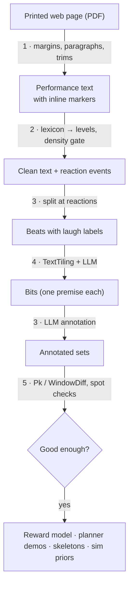

# Pipeline wiki

Concept pages behind the transcript pipeline: what each technique is, why we use it, and
exactly how it's applied here. Read in order if you're new; each page links to the code.

| # | Page | Stage | One-line summary |
|---|---|---|---|
| 1 | [PDF extraction](pdf-extraction.md) | S0 | Getting clean transcript text out of browser-printed PDFs |
| 2 | [Reaction markers & laugh labels](laugh-labels.md) | S1–S2 | Turning `[audience laughs]` into consistent 0–4 labels across transcribers |
| 3 | [Beats, bits, sets](beats-bits-sets.md) | S3, S5 | The three units of stand-up structure and how we label them |
| 4 | [TextTiling](texttiling.md) | S4 | Finding where one bit ends and the next begins |
| 5 | [Segmentation evaluation](segmentation-evaluation.md) | S6 | Pk and WindowDiff: scoring bit boundaries against hand labels |
| 6 | [Memorization guard](memorization-guard.md) | generation | Stopping the agent from repeating comedians' lines |

How it all ends up as clean, labeled transcripts:

